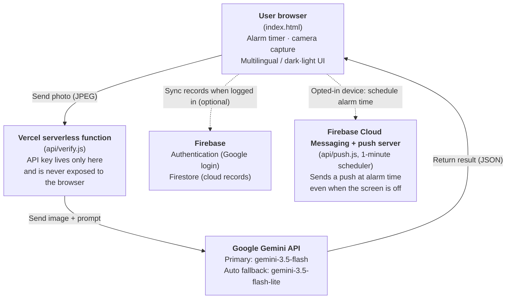

# 💧 Water-Cycle (Hydration Timer Project)

**🌐 Language**: [한국어](./README.md) · English (this document) · [日本語](./README.ja.md) · [中文](./README.zh.md)


> Entry for the 4th NAVER OGQ Market AI Competition · Team **AI도 놀랄 팀 (Even AI Would Be Surprised)**
> Category: ① IT·SW·Robotics

**🔗 Live demo**: https://drink-water-five-drab.vercel.app/
**🔗 Judge live demo**: https://drink-water-five-drab.vercel.app/?judge=1 (shows a button to trigger an alarm instantly; this visit is excluded from the statistics)
**🎥 3-minute pitch (before the Top 30 selection)**: https://youtu.be/ApWkJ1hUQ2w
**🎥 Week 4 3-minute pitch**: https://youtu.be/brr7TZhIT9o
**🎥 Final 3-minute pitch**: https://youtu.be/ZgaB6vrxH0U
**🎥 10-minute pitch (Week 7)**: https://youtu.be/JCmAw9Xpjqg

---

> ### 📌 TL;DR
> - **What**: A web app that solves the problem of industrial workers missing their moment to drink water — the alarm only turns off after AI verifies, from a photo, that the user is actually drinking.
> - **Why AI**: A button click or a QR scan cannot prove someone really drank. AI Vision verification is the only way to confirm.
> - **Status**: Live in production, 8 languages, cloud sync on login, in-app measurement, bug/suggestion reporting and push alerts that work with the screen off all implemented.
> - **Measured results**: 33 visitors → 15 started → 15 completed → 7 returned / 13 users verified successfully in the last 7 days (North Star, goal 10), per the owner-only dashboard (see "14. Measurement & Improvement").

---

## Overview

**Water-Cycle** is an attendance-linked health-management project for environments such as cleanrooms and production floors, where workers easily neglect hydration. At set intervals it leads workers to step away from their station, drink water, and **verify it with AI**. It is not a one-off awareness challenge: it designs a repeatable routine (Cycle) that fits real work movement, achieving habit formation and verification at the same time.

The name **Water-Cycle** reflects one closed loop — alarm → move → drink → verify — and the idea that habits accumulate as the cycle repeats.

## 1. Problem Definition

Our team consists of students of Chungnam Semiconductor Meister High School, so we first pictured the environment most familiar to us: the semiconductor fab cleanroom. Cleanroom entry involves cleanroom suits and air showers, which makes even drinking water harder than in an ordinary office, and long periods of focused work mean people either don't notice thirst or can't act on it.

However, six real user interviews at a semiconductor industry exhibition revealed two new facts. First, **general industrial workers who do not wear cleanroom suits suffer from the very same problem — "I don't have time, or I can't be bothered, so I don't drink much."** Second, cameras are banned inside fab cleanrooms and gloves make touch input difficult, so our original "AI photo verification" is hard to apply in precisely the setting we first imagined.

We therefore widened the problem from the semiconductor industry to **industrial workers in general who struggle to manage their own hydration timing**. In general manufacturing, logistics and service sites, where cameras are allowed, AI photo verification applies as is; environments where cameras are restricted, such as semiconductor cleanrooms, are treated as a separate future task (see Section 9).

Chronic dehydration can lead to reduced concentration, accumulated fatigue and a higher risk of accidents.

Existing alarm apps and tap-to-check checklists have a fundamental limit: they cannot bridge the gap between "I noticed the alarm" and "I actually drank water." **Water-Cycle closes that gap with AI Vision.** The alarm rings at the set time, and it is only dismissed after the user films themselves drinking and the AI confirms it. Enforcing the habit through behavior verification, not mere notification, is our core differentiator.

### Benefit of using the existing work route
Hydration is attached to the "leave the work area → rest area" route workers already take, which reduces psychological resistance to "wasted time" and improves acceptance on site.

## 2. Usage Scenario (Full Cycle)

```
① Notice alarm → ② Finish task → ③ Leave work area → ④ Drink at the water station → ⑤ AI verification in the app → (wait for next alarm, back to ①)
```

Steps **① and ⑤ (alarm, AI photo verification)** are implemented in the app; ②–④ are the physical movements workers perform on site.

## 3. Architecture

The browser (frontend) never knows the AI API key. It only sends the captured photo to our own backend, and the backend calls the AI API using the key stored in an environment variable. AI verification is redundant: if the primary model does not respond, it switches automatically to a fallback model within the same service. Record storage splits between browser storage and the cloud depending on whether the user is logged in.



- Captured images are sent once to the Google Gemini API for verification; we do not store them on our servers or database and discard them right after the check. Under the Gemini free-tier terms we currently use, Google may use submitted content to improve its services and human reviewers may see it, so the in-app consent screen discloses this and asks users to show their hand and cup instead of their face. We plan to move to the paid tier, which does not use inputs for training, as usage grows.
- **Every feature works without logging in.** Today's records, statistics and settings are kept in browser storage and survive reloads.
- **When logged in with a Google account**, the same records are stored in Firestore (cloud), persist across devices and browser resets, and the last 14 days can be viewed separately.
- **Alerts when the screen is off (optional)**: Phones pause web pages when the screen turns off, so when a user turns alerts on, the alarm time is scheduled on the server (`api/push.js`) at timer start, and a 1-minute scheduler (cron-job.org) triggers a Firebase Cloud Messaging push for due alarms. It repeats every minute, up to 5 times, until verification.

## 4. Tech Stack

| Area | Technology |
|---|---|
| Frontend | HTML / CSS / Vanilla JavaScript (no framework) |
| Backend | Vercel Serverless Functions (Node.js) |
| AI model | Google Gemini — `gemini-3.5-flash` (primary) / `gemini-3.5-flash-lite` (automatic fallback) — Vision API |
| Login · cloud storage | Firebase Authentication (Google login), Cloud Firestore |
| Measurement · reports | Firestore `events` (anonymous events) · `feedback` (inbox), Web3Forms (report e-mail delivery) |
| Push notifications | Firebase Cloud Messaging (web push), service worker, Firebase Admin SDK (`api/push.js`), cron-job.org (1-minute scheduler) |
| Bonus | OGQ Market API — sticker reward on successful verification (`api/sticker.js`) |
| Deployment | Vercel |
| Version control | GitHub |
| Languages | 한국어 / English / 日本語 / 中文 / Tiếng Việt / ภาษาไทย / Bahasa Indonesia / Tagalog (8 languages, in-house i18n) |

## 5. How to Run

### Try it right away (recommended)
Open the [live demo](https://drink-water-five-drab.vercel.app/) → press **"⚡ Test alarm now (judges)"** (shown when `?judge=1` is appended to the URL; this visit is excluded from the statistics) to trigger an alarm without waiting → film yourself drinking → see the AI verdict.
(All features work without logging in; Google login can optionally be tested at the top right.)

### Run locally
```bash
git clone https://github.com/ljh30581712-beep/drink-water.git
cd drink-water
npm i -g vercel
vercel dev
# Register these environment variables before running:
#  - GEMINI_API_KEY : issued at Google AI Studio (https://aistudio.google.com/apikey)
#  - OGQ_API_KEY    : (optional) for OGQ Market stickers; the core feature works without it
# To use login / cloud storage, create a Firebase project and replace
# the firebaseConfig values in index.html with your own.
```

### Deploy
1. Import the GitHub repository into Vercel
2. In Vercel Project Settings → Environment Variables, add `GEMINI_API_KEY` (required) and `OGQ_API_KEY` (optional). For push notifications, also add `FIREBASE_SERVICE_ACCOUNT` (Firebase service account JSON) and `CRON_SECRET` (any random string)
3. Deploy
4. (Optional) Enable Authentication (Google login) and Firestore in the Firebase console, and add the deployed domain to "Authorized domains"
5. (Optional) Publish the Firestore rules (`firestore.rules`): `events` and `feedback` are write-only; reading is limited to the owner account
6. (Optional) Report e-mail: enter the Access Key from web3forms.com into `EMAIL_FORM_KEY` in `index.html`
7. (Optional) Push notifications: in Firebase console → Cloud Messaging, create a Web Push certificate (VAPID key) and put it in `VAPID_KEY` in `index.html`, then register an external scheduler such as cron-job.org to call `/api/push?key=<CRON_SECRET>` every minute

## 6. AI Usage

**Core feature (essential part of the service)**

| Item | Details |
|---|---|
| AI model | Google Gemini — `gemini-3.5-flash` (primary), `gemini-3.5-flash-lite` (fallback) |
| How it is used | Analyzes one user-captured photo with Vision (image understanding) to decide whether the person is drinking water/a beverage. Receives the result (true/false) and a short reason as JSON and decides whether to dismiss the alarm |
| Why redundancy | When a popular model responds slowly, the service automatically switches to a lighter model in the same service to keep it stable |
| Scope | **AI photo verification is the only verification method.** A button click or a QR scan alone never completes verification; the service does not work without AI. |
| Supporting API | OGQ Market API — awards an OGQ Market sticker as a reward after successful verification (`api/sticker.js`). It is a bonus feature separate from the AI judgment; if the call fails, verification, alarms and every other core feature keep working |

**Development assistance tools (used in planning and building)**

| Tool | Purpose |
|---|---|
| Claude (Anthropic) | All code writing and debugging, architecture design, deployment guidance |
| Gemini | Idea generation and planning support |
| HyperCLOVA X | Writing assistance for Markdown documents such as the README (syntax and wording polish) |
| ChatGPT (image generation) | Team logo |

## 7. Privacy & Ethics (P/F Checklist)

| Check item | Response |
|---|---|
| **Privacy** | Captured images are sent once to the Google Gemini API for verification and are not stored on our servers or database. Because the Gemini free-tier terms allow Google to use submitted content to improve its services and let human reviewers see it, the consent screen discloses this and asks users to keep their face out of the shot (moving to the paid tier as usage grows). There is no face recognition or identity detection — only "was the person drinking?" is judged. What is stored on login is only hydration records and settings; measurement events use a random anonymous ID and contain no name, photo or location. Firestore security rules restrict access so that users can only reach their own data. Push alerts run only if the user turns them on; then only the device notification address, the next alarm time and language are stored briefly on the server, and are deleted when the alarm ends or the feature is turned off. |
| **Copyright** | Only self-made or open-source / free-license code, icons and fonts are used. |
| **AI-generated content disclosure** | The AI models used and their scope are disclosed in "6. AI Usage". |
| **Minor safety** | The service is designed for adult industrial workers and does not assume use by minors. |

## 8. Implemented Features

- **Alarm system**: a single alarm at the configured interval; today's records can be reset
- **5-minute snooze**: if immediate verification is hard (hazardous work, moving around), the "5-minute snooze" button silences the alarm and re-arms it after 5 minutes. **Allowed only once per alarm**; after it rings again, it keeps ringing until the user actually drinks and passes AI verification.
- **AI verification**: camera capture → Gemini Vision verdict (automatic fallback model if the primary fails) → alarm dismissed; a retake button is offered on failure
- **Login · cloud records (optional)**: logging in with Google stores records in Firestore so they persist across devices, and the last 14 days can be viewed. Without logging in, it works the same using browser storage.
- **Statistics**: real-time counts of today's attempts / successes / failures, success rate and average verification interval
- **Multilingual**: live switching among 한국어 / English / 日本語 / 中文 / Tiếng Việt / ภาษาไทย / Bahasa Indonesia / Tagalog (the AI's reasoning is also returned in the chosen language)
- **Dark / light mode**: instant theme switching
- **Accessibility / reliability**: offline indicator, screen-reader labels, cause-specific error messages (quota exceeded / timeout / server busy / network, etc.)
- **OGQ sticker reward**: shows an OGQ Market sticker on successful verification (failures do not affect the core feature)
- **Settings**: vibration, 3 alarm sounds, day-start time (for shift work), pre-capture screen flash, privacy consent notice
- **Anonymous measurement**: visit / start / complete / return / error events recorded under an anonymous ID (viewable on the owner dashboard)
- **Bug & suggestion reports**: in-app 💬 Report button → delivered to the inbox and by e-mail simultaneously
- **Alerts that work with the screen off (push)**: when turned on in settings, the server sends a push at alarm time and repeats every minute, up to 5 times, until verification (stops when the user returns to the app). Alerts can be up to 1 minute late, and iPhone receives them only in an app added to the Home Screen.
- **Alert guide window**: explains the setup steps for iPhone and Android inside the app, and warns users of in-app browsers (Naver, KakaoTalk) to reopen in Safari or Chrome. It opens once automatically the first time the timer starts.
- **Timer correction**: remaining time is computed from the end time, so it stays accurate when the screen turns off and on, and the alarm rings as soon as the user returns. A screen wake lock is also requested while the timer runs.

## 9. Future Ideas

The following are not yet implemented; we plan to keep developing them after the 8-week coaching period.

- **Dual alarm structure**: a second alarm matched to the time workers leave their work area
- **Automatic shift-pattern adjustment**: change the alarm interval automatically with shift changes
- **QR entry tagging**: QR codes at site entrances; scanning when leaving records the exit time automatically and adjusts the hydration alarm timing (verification itself stays AI photo-based; QR only helps identify the exit moment)
- **Support for camera-restricted sites**: for places such as semiconductor cleanrooms where cameras are banned or gloves make touch hard, consider alternatives such as a flow sensor at the water station or an ID-badge tag (a response to constraints confirmed in interviews at the semiconductor exhibition)
- **Admin dashboard**: department/line-level aggregates, reminders for low-compliance workers, downloadable (Excel/PDF) reports
- **Data-linked analysis**: link verification data with company health-check data; automatically shorten alarm intervals in heat waves
- **Visualization**: heat map of water-station usage by location

## 10. Industry Use Cases

Water-Cycle's core principle (**"alarm at set times → verify the real behavior with AI"**) is not limited to one industry and **applies as is wherever hydration needs managing**.

| Site | Example |
|---|---|
| Semiconductor fab cleanroom | Workers in cleanroom suits. Areas where cameras are banned need the alternative verification in Section 9 (sensor / badge tag) |
| Hospitals (operating rooms, ICU, etc.) | Medical staff in sterile gowns who easily miss hydration during long operations |
| Construction sites | Preventing heat illness for outdoor workers in summer heat |
| Distribution centers / general factories | The same structure for a wide range of production workers |
| Call centers / office work | Environments where people sit for long hours and forget to drink |
| Care facilities | Adapted as a reminder tool for caregivers of elderly people who cannot sense or express thirst |
| Sports / fitness | Managing the timing of fluid replacement during intense exercise |

Keep the structure — "verify behavior with AI photo judgment" — and change only the alarm interval and the target user, and it becomes a **general-purpose solution reusable across industries**. That means **commercial potential**: not a niche product tied to one industry, but something that can be licensed B2B to many sectors or sold as SaaS.

## 11. Multilingual Localization Strategy

Beyond simply translating UI text into eight languages, we considered the user experience in each language community.

- **Languages chosen from the field**: we prioritized the languages of migrant workers' home countries in Korean manufacturing sites.
- **Tone localization**: Japanese uses polite (丁寧語) wording suited to industrial tools; English uses concise instructions as in international workplaces. We did not paste machine translation; we composed natural sentences per language.
- **Language-linked AI results**: the "reason" returned after photo judgment is generated directly in the user's selected language, because the language is sent to the server together with the photo. This avoids a half-multilingual design where only the UI is translated and the AI answers only in Korean.
- **Customer support in eight languages**: the in-app FAQ is provided identically in eight languages so users can solve problems on their own without a language barrier.
- **Multilingual documentation**: this README is provided in four languages (Korean, English, Japanese, Chinese) so overseas reviewers and adopting companies can check the structure and setup right away.

## 12. Maintenance & Technical Support

Assuming deployment to real industrial sites as a B2B solution, we have designed and applied the following operating system.

### Deploy / update process
- Code is managed on the GitHub `main` branch, and Vercel redeploys automatically when a commit lands.
- The frontend needs no installation or app update; the latest version applies as soon as the user reloads the page.
- The backend (serverless functions) uses the same pipeline, so it always matches the frontend version.

### Issue-response process
1. **Monitoring**: check errors and traffic in real time via Vercel function logs and the Google AI Studio usage dashboard.
2. **Root-cause classification**: separate errors into network / AI-service outage / code defect. (During development we diagnosed and handled 504 timeouts, 503 server congestion and 404 model retirement differently using this method.)
3. **Patch and redeploy**: once the cause is confirmed, fix the code, commit, and let automatic redeployment apply it immediately.
4. **Record**: keep the response in the "Development History" (Section 15 below) for quick reference if the same problem recurs.

### Support channels (planned)
- **Tier 1 self-service**: the in-app multilingual FAQ covers frequent issues (silent alarm, camera errors, etc.)
- **Tier 2 contact**: the in-app 💬 report button is already in operation for bugs and suggestions; GitHub Issues will be added as an official bug-report channel
- **Response goal**: first response within 24 hours for service-outage-level errors (currently a team-project target; to be formalized as an SLA when commercialized)

### Operations Plan After Week 8
- **Error handling**: Errors and suggestions sent through the in-app 💬 report button reach the inbox and email immediately, and we fix them as soon as we confirm them. We also check the AI error log (type, status code, duration) on the live dashboard regularly, and analyze and fix any error that appears.
- **Running cost**: We currently run within free-tier limits, so there is no fixed monthly cost (hosting: Vercel; database, login and push notifications: Firebase; alert scheduler: cron-job.org). Costs arise only if usage grows past the AI verification (Gemini) quota, at which point we will consider a paid plan sized to usage. Photos are not stored on our server, so there is no storage cost either.
- **Growing the user base**: We opened an Instagram account (@water_cycle.ai) and are preparing Reels to promote the product. We track whether new users come back on the dashboard and improve accordingly.
- **App store release plan**: After stabilizing the web service, we plan to publish the app on the App Store (iOS) and Google Play (Android), to deliver alerts more reliably when the screen is off and make installation easier.

### Future plans
- Introduce a `CHANGELOG.md` to track release history
- Write a separate operations guide for administrators at adopting companies

## 13. Expected Impact

- **Health**: less fatigue, sustained concentration and heat-illness prevention through regular hydration
- **Safety**: prevent momentary concentration lapses from thirst or dehydration and reduce industrial accident risk
- **Operations**: build the habit with no extra time loss by using the existing work route
- **Data**: accumulated verification data can serve as individual / department health-management indicators

## 14. Measurement & Improvement (W6–W8)

### Metrics the app records itself
We measure with **anonymous events the app records on its own**, not with surveys. No personally identifying information is stored; only a random anonymous ID generated per browser is used.

| Event | Meaning |
|---|---|
| visit | Opened the link |
| start | Tried to take a photo |
| complete | Passed AI verification |
| return | Came back on a different day |
| error | An AI error occurred (only type, status code and duration recorded) |

Team members' and judges' visits (`?judge=1`) are flagged as `internal` and excluded from the statistics.

### Measured results (owner dashboard)
| Funnel step | Users |
|---|---|
| Visit | 33 |
| Start | 15 |
| Complete | 15 |
| Return | 7 |

- **North Star metric**: **13** external users who passed AI verification at least once in the last 7 days (W1 start 0 → goal 10; 130% of goal)
- The largest drop-off is **visit → start (33 → 15, 54.5%)**; all 15 users who tried to take a photo passed verification.
- Users who came back on another day: **7 / 33 (21.2%)**. Of 30 week-1 users, 4 (13.3%) came back in week 2 (10/12 only), which is provisional because week 2 is a single day.
- Measurement period 2026-10-05 ~ 10-12 (8 days); 321 external events, with 57 team/judge events excluded. The sample is small, so the numbers show direction only. (Dashboard captures are attached to the W8 final KPI report.)

### Dashboard access
`stats.html` (funnel · retention · daily · AI error log) and `inbox.html` (report inbox) show data **only after logging in with the owner's Google account**. Even though the page URLs are public, the data is blocked by Firestore security rules. For judging, dashboard captures are attached to the submission.

### Bug & suggestion reporting
- Anyone can send a bug or suggestion with the **💬 Report** button next to the "Online" indicator at the top of the app.
- Reports are delivered simultaneously to ① the Firestore inbox (viewable at `inbox.html`) and ② the owner's e-mail. A report counts as received if either one succeeds.
- Each report carries the most recent AI error type and duration to help find the cause. No names or contact details are collected.

### What measurement helped us find and fix
| Finding | Action |
|---|---|
| Intermittent timeout (504) errors | Automatically log type and duration to distinguish server time limits from AI-side rejections (503·429) |
| Survey comment: "laggy while typing in settings" | Stop re-rendering the whole screen every second while the settings panel is open |
| No channel for reporting errors | Added in-app report button + inbox + e-mail delivery |
| Interval reset from 5 to 30 minutes after a drink | Do not save until the cloud load has finished |
| Past records and intake overwritten with 0 when logged in | Replaced the structure where stale tabs/devices overwrote server records; now saves only when values actually change |
| Timer stops when the phone screen turns off | End-time-based calculation + screen wake lock + server push notifications |

## 15. Development History (Issue Response Log)

| Stage | Problem | Solution |
|---|---|---|
| Structure change (v1 → v2) | The frontend called the AI API directly, so it couldn't work outside the dev environment | Rebuilt as a separated frontend–backend architecture with the API key kept only on the server |
| AI verdict failures | Response-parsing issues caused false negatives even for real drinking | Switched to structured JSON responses and made the criteria lenient |
| 504 timeout | Server cold start + AI analysis exceeded the function time limit | Raised the function limit and optimized image resolution for speed |
| 503 server congestion | The Gemini server returned temporary overload due to the popular model | Introduced redundancy that automatically switches to a fallback model in the same service |
| Silent / weak alarm | Browser autoplay policy and mobile environments produced no or low sound | Pre-activate audio on user click, resume logic on screen change, higher volume, added vibration |
| Confusing error messages | Raw status codes were shown, so users couldn't tell the cause | Cause-specific (quota / timeout / server busy / network) messages in the selected language |
| Lost records | Browser-only storage lost records on device change or browser clearing | Added Google login + Firestore cloud storage (login stays optional) |
| Redefining the target | Six interviews at the semiconductor exhibition showed that fab cleanrooms ban cameras and gloves make touch hard, so AI photo verification is hard to apply there; yet general industrial workers without cleanroom suits have the same hydration problem | Widened the target from semiconductor-only to industrial sites without camera restrictions; camera-banned environments (e.g., fab cleanrooms) were split off as a separate future task |
| No measurement | No way to know actual usage beyond surveys | In-app anonymous event measurement + owner-only dashboard (funnel · retention · North Star) |
| Unknown cause of timeouts | A 504 could be a server problem or an AI rejection, with no way to tell | Record type / status / duration in `error` events, plus user reports via inbox and e-mail |
| Interval reset | On login, the previous state was saved before cloud values loaded, reverting 5 minutes to 30 | Stop saving while loading |
| Past records overwritten with 0 | Other tabs/devices open on the same account overwrote the server with stale state every second | Save only when values actually change; verified with a two-tab reproduction test |
| No alarm when the screen is off | The phone pauses the browser when the screen turns off, so the in-app timer cannot run | End-time-based timer + a server that sends a push at alarm time (FCM, 1-minute scheduler) |
| In-app browser login blocked | Google sign-in is blocked by policy inside in-app browsers such as Naver and KakaoTalk (`disallowed_useragent`); Naver login is not a built-in Firebase provider | Detect in-app browsers and show guidance to open in Chrome/Safari; keep Google as the single sign-in method and keep no-login use fully available |
| Skewed dashboard numbers | Visitor/retention metrics mixed in developer and test-device events, and return rate was inaccurate when the current week had only one day of data | Excluded internal events, de-duplicated by anonymous user ID, and stated the limits of short-window metrics in the report |
| Background push (the longest task) | Push is not just app code: VAPID key, service account, server env vars, an external scheduler (Vercel's free plan has no per-minute cron) and iOS home-screen installation must all line up; several setup errors occurred | Settled on a server function (`api/push.js`) plus a 1-minute external scheduler, kept secrets in env vars only (an exposed key was revoked and reissued immediately), and added an in-app setup guide per environment |

## Closing

**Water-Cycle** aims to establish hydration habits in a variety of industrial sites without friction through one complete loop — "alarm → finish → leave → drink → AI verification". The project's core direction is to raise on-site acceptance by making the most of existing work routes and to keep improving the system based on AI verification data.

## License

This project is licensed under the [MIT License](./LICENSE).
