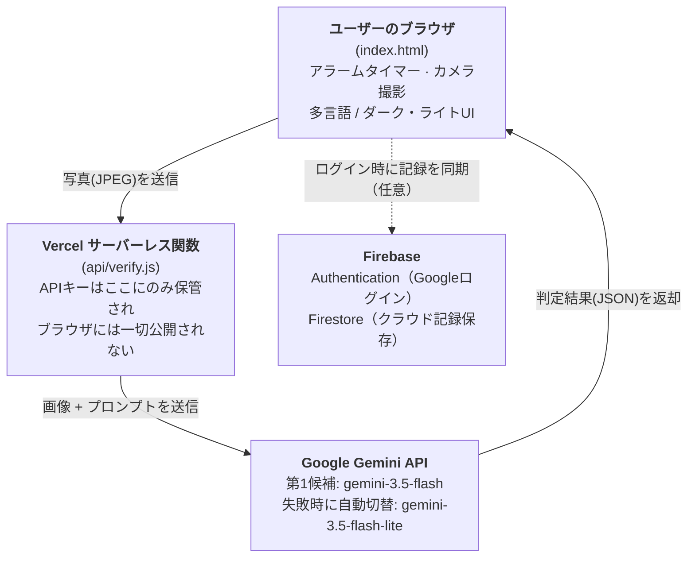

# 💧 Water-Cycle（水分補給タイマープロジェクト）

**🌐 Language**: [한국어](./README.md) · [English](./README.en.md) · 日本語（本ドキュメント） · [中文](./README.zh.md)


> 第4回 NAVER OGQマーケット AI Competition 出品作 · チーム **AI도 놀랄 팀（AIも驚くチーム）**
> 分野：① IT・SW・ロボット

**🔗 ライブデモ**: https://drink-water-five-drab.vercel.app/
**🔗 審査用ライブデモ**: https://drink-water-five-drab.vercel.app/?judge=1 （待たずにすぐアラームを体験できるボタンが表示されます。このアクセスは統計から除外されます）
**🎥 30チーム選抜前の3分スピーチ動画**: https://youtu.be/ApWkJ1hUQ2w
**🎥 4週目の3分スピーチ動画**: https://youtu.be/brr7TZhIT9o
**🎥 最終3分スピーチ動画**: https://youtu.be/ZgaB6vrxH0U
**🎥 10分ピッチ動画（7週目）**: https://youtu.be/JCmAw9Xpjqg

---

> ### 📌 ひと目でわかる（TL;DR）
> - **何を**: 産業現場の作業者が水を飲むタイミングを逃す問題を、AIが写真で実際の飲水行動を確認しないとアラームが止まらないWebアプリで解決
> - **なぜAIか**: ボタン操作やQRだけでは「本当に飲んだか」を確認できない — AI Visionによる判定が唯一の認証手段
> - **現状**: ライブ公開済み、8言語対応、ログイン時のクラウド保存、アプリ内の実測計測・不具合/要望の報告機能まで実装
> - **実測結果**: 訪問12人 → 開始7人 → 完了7人 → 再訪問3人 / 直近7日間に認証に成功したユーザー（北極星指標）7人（オーナー専用ダッシュボード基準、下記「14. 計測と改善」参照）

---

## プロジェクト概要

**Water-Cycle（水分補給タイマープロジェクト）** は、クリーンルームや生産現場など、勤務の性質上水分補給がおろそかになりやすい環境で、決まった周期ごとに作業者が自然に作業場を離れて水分を摂り、それを **AIで認証** するよう促す、勤怠連動型の健康管理プロジェクトです。単なるキャンペーン的なチャレンジではなく、実際の作業動線と結び付いた繰り返し可能なルーティン（Cycle）を設計し、習慣化と認証を同時に達成することが核心です。

**Water-Cycle** という名前は、アラーム → 移動 → 摂取 → 認証と続く一つの循環構造（Cycle）を意味し、このサイクルが繰り返されるほど習慣が積み重なることを象徴しています。

## 1. 問題定義

私たちのチームは忠南半導体マイスター高校の在校生で構成されているため、最初は自分たちに最も身近な半導体ファブのクリーンルーム勤務環境を問題の舞台として思い描きました。半導体ファブは防塵服の着用やエアシャワーなど入室手順が厳しく、一般的なオフィスよりも水を飲む行為そのもののハードルが高く、長時間の集中作業で喉の渇きに気付かない、あるいは気付いても行動に移しにくいという構造的な問題があります。

ところが、半導体産業の展示会会場で行った実際のユーザーインタビュー（6件）で、新たに2つのことが分かりました。第一に、**防塵服を着ない一般の産業労働者も「水を飲む時間がない、または面倒であまり飲まなくなる」という同じ問題を抱えていました。** 第二に、半導体ファブのクリーンルームはカメラの持ち込み自体が禁止されており、防塵服の手袋のせいでタッチ操作も難しいため、私たちが当初考えた「AI写真認証」は、むしろ半導体の現場では適用しにくいという現実的な制約も見つかりました。

そこで私たちは、問題の範囲を半導体産業に限定せず、**水分補給のタイミングを自分で管理しにくい産業現場の作業者全般**へ広げました。カメラの使用に制約のない一般の製造・物流・サービス現場ではAI写真認証をそのまま適用し、カメラ持ち込みが制限される半導体クリーンルームのような特殊環境への対応は、今後の拡張課題（セクション9参照）として別に扱うことにしました。

これによる慢性的な水分不足は、集中力の低下、疲労の蓄積、安全事故のリスク増加につながるおそれがあります。

従来の単純なアラームアプリやボタン式のチェックリストには、「アラームに気付いた」と「実際に水を飲んだ」の間のギャップを確認する方法がないという根本的な限界があります。**Water-Cycleはこのギャップを AI Vision で埋めます。** 決まった時間にアラームが鳴り、ユーザーが実際に水を飲む姿を撮影して初めて、AIが判定してアラームを解除します。単なる通知ではなく「行動の検証」によって習慣を定着させることが、核心的な差別化ポイントです。

### 既存の動線を活用する利点
作業者がどのみち通る「退室 → 休憩スペース」という動線に水分補給を自然に組み込むことで、追加の時間ロスに対する心理的抵抗を減らし、現場での受容性を確保します。

## 2. 実際の利用シナリオ（全サイクル）

```
① アラーム確認 → ② 作業を区切る → ③ 作業エリアから退室 → ④ 給水所で水分補給 → ⑤ アプリでAI認証 → （次のアラームまで待機、①へ循環）
```

このうち **①と⑤（アラーム発生、AI撮影認証）** が現在アプリで実装されており、②〜④は作業者が実際の現場で行う物理的な動線です。

## 3. アーキテクチャ

ブラウザ（フロントエンド）はAI APIキーを一切知りません。撮影した写真を自社のバックエンドサーバーにだけ送信し、バックエンドが環境変数に保存されたキーで代わりにAI APIを呼び出します。AI判定は、メインモデルが応答しない場合に備えて同じサービス内の代替モデルへ自動切り替えする冗長構成にしており、記録の保存はログインの有無によってブラウザ保存領域またはクラウドに分かれます。



- 撮影された画像は判定後ただちに破棄され、サーバーやデータベースのどこにも保存されません。
- **ログインしなくてもすべての機能をそのまま利用できます。** この場合、今日の認証記録・統計・設定はブラウザの保存領域に保管され、再読み込みしても保持されます。
- **Googleアカウントでログインすると**、同じ記録がFirestore（クラウド）に保存され、端末を変えたりブラウザを消去したりしても維持され、過去14日分の記録を別途閲覧できます。

## 4. 使用スタック

| 領域 | 技術 |
|---|---|
| フロントエンド | HTML / CSS / Vanilla JavaScript（フレームワークなし） |
| バックエンド | Vercel Serverless Functions (Node.js) |
| AIモデル | Google Gemini — `gemini-3.5-flash`（第1候補） / `gemini-3.5-flash-lite`（失敗時に自動切替） — Vision（画像理解）API |
| ログイン · クラウド保存 | Firebase Authentication（Googleログイン）、Cloud Firestore |
| 計測 · 報告 | Firestore `events`（匿名イベント） · `feedback`（報告ボックス）、Web3Forms（報告メール転送） |
| ボーナス | OGQマーケットAPI — 認証成功時のステッカー報酬（`api/sticker.js`） |
| デプロイ | Vercel |
| バージョン管理 | GitHub |
| 多言語 | 한국어 / English / 日本語 / 中文 / Tiếng Việt / ภาษาไทย / Bahasa Indonesia / Tagalog（計8言語、自前実装のi18n） |

## 5. 実行方法

### すぐに試す（推奨）
[ライブデモ](https://drink-water-five-drab.vercel.app/)にアクセス → **「⚡ 今すぐアラームテスト（審査用）」** ボタン（URLの末尾に `?judge=1` を付けると表示。このアクセスは統計から除外）で待たずにすぐアラームを体験 → カメラで水を飲む姿を撮影 → AI判定結果を確認
（ログインなしで全機能を体験でき、右上からGoogleログインも任意で試せます。）

### ローカルで実行する
```bash
git clone <このリポジトリのURL>
cd water-cycle
npm i -g vercel
vercel dev
# 実行前に環境変数を登録する必要があります。
#  - GEMINI_API_KEY : Google AI Studio (https://aistudio.google.com/apikey) で発行
#  - OGQ_API_KEY    : （任意）OGQマーケットのステッカー用。なくても主要機能は動作
# ログイン/クラウド保存機能を使うには、Firebaseプロジェクトを作成し、
# index.html の firebaseConfig の値をご自身のプロジェクトの値に差し替えてください。
```

### デプロイする
1. GitHubリポジトリをVercelにImport
2. VercelプロジェクトのSettings → Environment Variablesに `GEMINI_API_KEY`（必須）、`OGQ_API_KEY`（任意）を登録
3. Deploy
4. （任意）FirebaseコンソールでAuthentication（Googleログイン）とFirestoreを有効化し、デプロイしたドメインを「承認済みドメイン」に追加
5. （任意）Firestoreルール（`firestore.rules`）を公開：events・feedbackは書き込み専用、読み取りはオーナーアカウントのみ
6. （任意）報告メール：web3forms.comで受け取ったAccess Keyを `index.html` の `EMAIL_FORM_KEY` に入力

## 6. AI活用の明細

**中核機能（サービスの必須構成要素）**

| 項目 | 内容 |
|---|---|
| 使用AIモデル | Google Gemini — `gemini-3.5-flash`（第1候補）、`gemini-3.5-flash-lite`（代替） |
| 活用方法 | ユーザーが撮影した写真1枚をVision（画像理解）機能で分析し、「水・飲み物を飲む動作か」を判定。判定結果（true/false）と短い理由をJSONで受け取り、アラームを解除するかを決定 |
| 冗長化の理由 | 人気モデルの特性上、応答が一時的に遅れる場合に、同じサービス内のより軽いモデルへ自動で切り替え、サービスの安定性を高めました |
| 活用範囲 | **認証方法はAI写真判定が唯一です。** ボタン操作やQRスキャンだけでは認証は完了せず、AI判定なしにはサービスが成り立ちません。 |

**開発補助ツール（企画・制作過程で活用）**

| ツール | 活用目的 |
|---|---|
| Claude (Anthropic) | コード全体の作成とデバッグ、アーキテクチャ設計、デプロイ方法の案内 |
| Gemini | アイデア出しと企画補助 |
| HyperCLOVA X | READMEなどMarkdown文書作成時の文法活用と文章表現を整える作文補助 |
| ChatGPT（画像生成） | チームロゴの制作 |

## 7. 個人情報と倫理（P/Fチェックリスト）

| 確認項目 | 対応内容 |
|---|---|
| **個人情報保護** | 撮影された画像はAI判定の目的で1回送信された後ただちに破棄され、サーバー・データベースのどこにも保存されません。顔認識や本人識別の機能はなく、「飲水行動かどうか」のみを判定します。ログイン時に保存される情報は水分摂取記録と設定値のみで、計測用イベントはランダムな匿名IDでのみ記録され、氏名・写真・位置情報は含まれません。Firestoreのセキュリティルールにより、本人のアカウントのデータにのみアクセスできるよう制限しています。 |
| **著作権** | コード・アイコン・フォントは、自作またはオープンソース/無料ライセンスのリソースのみを使用しました。 |
| **AI生成物の表記** | 使用したAIモデルと活用範囲を「6. AI活用の明細」に明記しました。 |
| **未成年者の安全** | 本サービスは産業現場の成人作業者を対象に設計されており、未成年者の利用を前提としていません。 |

## 8. 現在実装されている機能

- **アラームシステム**: 設定した周期に従って単発のアラームが発生、今日の記録のリセット機能
- **5分スヌーズ**: 危険な作業中や移動中で即座の認証が難しい場合、「5分延期」ボタンでアラームを一時停止し、5分後に再び鳴るよう再設定。**アラーム1回につき1度だけ許可**され、その後再び鳴ったら、実際に水を飲んでAI認証を完了するまで鳴り続けます。
- **AI認証システム**: カメラ撮影 → Gemini Vision判定（第1候補が失敗したら代替モデルへ自動切替） → アラーム解除、失敗時は再撮影ボタンを提供
- **ログイン · クラウド記録保存（任意）**: Googleアカウントでログインすると記録がFirestoreに保存され、端末が変わっても維持され、過去14日分の記録を閲覧できます。ログインしなくてもブラウザ保存領域で同様に動作します。
- **統計**: 今日の試行/成功/失敗回数、成功率、平均認証間隔をリアルタイム集計
- **多言語**: 한국어 / English / 日本語 / 中文 / Tiếng Việt / ภาษาไทย / Bahasa Indonesia / Tagalog の8言語をリアルタイムで切り替え（AI判定の理由も選択した言語で返却）
- **ダーク/ライトモード**: 画面テーマを暗い/明るいトーンに即座に切り替え
- **アクセシビリティ/安定性**: オフライン状態の表示、スクリーンリーダー用ラベル、原因別のエラー案内（上限超過/タイムアウト/サーバー混雑/ネットワークなど）
- **OGQステッカー報酬**: 認証成功時にOGQマーケットのステッカーを報酬として表示（失敗しても主要機能には影響なし）
- **設定**: 振動、アラーム音3種、1日の開始時刻（交代勤務を考慮）、撮影前の画面フラッシュ、個人情報同意の案内
- **匿名計測**: 訪問・開始・完了・再訪問・エラーのイベントを匿名IDで記録（オーナー用ダッシュボードで確認）
- **不具合・要望の報告**: アプリ内の💬報告ボタン → 報告ボックスとメールへ同時に転送

## 9. 今後の拡張アイデア

以下の項目は、まだ実装されていない、8週間のコーチング期間中に発展させたい計画です。

- **二重アラーム構造**: 作業エリアの退室時間帯に合わせた2次アラームの追加
- **交代（シフト）パターンの自動調整**: 勤務交代に合わせてアラーム周期を自動変更
- **QRコードによる入退室タグ付け**: 事業所の出入口にQRコードを設置し、作業者が退室する際にQRをスキャンすると退室時刻が自動記録され、その時刻に合わせて水分補給アラームのタイミングを補正する機能（認証自体は現在と同じくAI写真判定を維持し、QRは「退室時点の把握」という補助的な役割）
- **カメラ持ち込み制限のある現場への対応**: 半導体ファブのクリーンルームのように、セキュリティ上カメラの持ち込み自体が禁止されていたり、防塵服の手袋でタッチ操作が難しかったりする特殊環境向けに、給水所に流量センサーを設置したり、社員証タグで認証したりする代替方式を検討（半導体産業展示会でのインタビューで実際に確認された制約への対応）
- **管理者ダッシュボード**: 部署/ライン単位の集計、認証率の低い人へのリマインド送信、統計レポート（Excel/PDF）のダウンロード
- **データ連携分析**: 認証データと社内の健康診断データの連携、季節（猛暑期）に応じたアラーム周期の自動短縮
- **可視化**: 給水所の場所別利用状況のヒートマップ

## 10. 適用産業の事例

Water-Cycleの核心原理（**「決まった時間にアラーム → 実際の行動をAIで検証」**）は特定の産業に限定されず、**水分補給の管理が必要なさまざまな現場にそのまま適用できます**。

| 現場 | 適用例 |
|---|---|
| 半導体ファブのクリーンルーム | 防塵服を着用する作業者が対象。ただしカメラ持ち込みが禁止されたエリアではセクション9の代替認証方式（センサー・社員証タグ）が必要 |
| 病院（手術室・集中治療室など） | 無菌服を着用し、長時間の手術で水分補給を逃しやすい医療従事者が対象 |
| 建設現場 | 夏の猛暑の中で屋外作業をする人の熱中症予防 |
| 物流センター・一般製造工場 | さまざまな生産職の作業者に同じ構造で適用 |
| コールセンター・事務職 | 長時間座って勤務し、水分補給を忘れやすい環境 |
| 介護施設 | 自分で喉の渇きを認識・表現しにくい高齢者の介護者・介護士向けの通知ツールとして応用 |
| スポーツ・フィットネス | 高強度の運動中の水分補給タイミングの管理 |

つまり「AI写真判定で行動を検証する」という構造そのものはそのままに、**アラーム周期とターゲットユーザーだけを変えれば、さまざまな産業で再利用できる汎用ソリューション**に拡張できます。これは単一産業に限定されたニッチな製品ではなく、B2Bで複数の産業にライセンス提供したり、SaaSとして販売したりできる**事業化の可能性**を意味します。

## 11. 多言語ローカライズ戦略

単にUI文言を8言語に翻訳するだけでなく、各言語圏のユーザー体験まで考慮しました。

- **現場に基づく言語選定**: 韓国の製造業の現場で働く移住労働者の出身国の言語を優先して反映しました。
- **文体のローカライズ**: 日本語は産業現場向けツールにふさわしい丁寧語の口調で、英語は国際的な業務環境で通用する簡潔な案内文の口調で、別々に作成しました。機械翻訳をそのまま貼り付けず、言語ごとに自然な文章を新たに構成しました。
- **AI判定結果の言語連動**: 写真判定後に返される「判定理由」のテキストも、ユーザーが選択した言語で直接生成されるよう、サーバーに言語情報を一緒に送ります。UIだけが翻訳されてAIの応答は韓国語のみという中途半端な多言語にならないよう設計しました。
- **カスタマーサポートの多言語化**: アプリ内の「よくある質問（FAQ）」も8言語で同様に提供し、言語の壁なく自分で問題を解決できるようにしました。
- **技術文書の多言語化**: アプリUI・FAQ・AI判定の理由まで8言語で提供し、韓国語が分からないユーザーも別の助けなしで利用できるようにしました。このREADMEも韓国語・英語・日本語・中国語で提供しています。

## 12. 保守および技術サポート体制

B2Bソリューションとして実際の産業現場に展開されることを想定し、以下の運用体制を設計・適用しています。

### デプロイ・アップデートのプロセス
- コードはGitHubの `main` ブランチで管理され、コミットが反映されるとVercelが自動で再デプロイします。
- フロントエンドは別途のインストールやアプリ更新なしで、ユーザーがページを再読み込みした時点で最新版が適用されます。
- バックエンド（サーバーレス関数）も同じデプロイパイプラインを使うため、常にフロントエンドと同じバージョンに保たれます。

### 問題対応のプロセス
1. **モニタリング**: Vercelの関数ログとGoogle AI Studioの使用量ダッシュボードで、エラーとトラフィックをリアルタイムに確認します。
2. **原因の分類**: エラーをネットワーク/AIサービス障害/コード不具合に分けて原因を絞り込みます。（例：今回の開発過程で、504タイムアウト、503サーバー混雑、404モデル廃止などを、この方法でそれぞれ別に診断し対応しました。）
3. **パッチと再デプロイ**: 原因が確認できたらコードを修正してコミットし、自動再デプロイで即座に反映します。
4. **記録**: 対応の過程を「開発履歴」（下記セクション15）に残し、同じ問題が再発した際にすばやく参照できるようにします。

### 技術サポートチャネル（計画）
- **1次セルフサポート**: アプリ内の多言語FAQで、よくある問題（アラームが鳴らない、カメラエラーなど）をすぐに確認できます
- **2次問い合わせチャネル**: GitHub Issuesを公式の問い合わせ・不具合報告窓口として運用予定
- **対応目標**: サービス停止級のエラーは、確認後24時間以内の1次対応を目標とする（現在はチームプロジェクト段階の目標値であり、実際の事業化の際にSLAとして具体化する計画）

### 今後の計画
- リリース履歴を追跡できる `CHANGELOG.md` の導入
- 導入企業の担当者向けの運用ガイド文書の作成

## 13. 期待される効果

- **健康面**: 定期的な水分摂取による疲労の軽減、集中力の維持、熱中症の予防
- **安全面**: 喉の渇きや脱水による一時的な集中力低下を防ぎ、産業安全事故のリスクを低減
- **運用面**: 既存の勤務動線を活用することで、別の時間ロスなしに習慣を定着できる
- **データ面**: 認証データの蓄積による、個人別/部署別の健康管理指標としての活用可能性

## 14. 計測と改善（W6〜W8）

### アプリが自ら記録する指標
アンケートではなく、**アプリ自身が残す匿名イベント**で計測します。個人を特定できる情報は保存せず、ブラウザごとにランダムに作った匿名IDのみを使います。

| イベント | 意味 |
|---|---|
| visit | リンクを開いた |
| start | 撮影を試みた |
| complete | AI認証に成功した |
| return | 別の日に再び訪れた |
| error | AIエラーが発生した（種類・ステータスコード・所要時間のみ記録） |

チームメンバーと審査用のアクセス（`?judge=1`）は `internal` と表示して集計から除外します。

### 計測結果（オーナーダッシュボード基準）
| ファネルの段階 | 人数 |
|---|---|
| 訪問 | 12 |
| 開始 | 7 |
| 完了 | 7 |
| 再訪問 | 3 |

- **北極星指標**: 直近7日以内にAI認証に成功した外部ユーザー **7人**（W1の目標：8週間後に10人）
- 開始（7人）と完了（7人）の人数が同じで、最も大きな離脱は **訪問 → 開始（12 → 7）** の区間
- 上記の数字はキャプチャ時点の値で、継続的に更新されます。（最終値は提出時点のダッシュボードのキャプチャで添付）

### ダッシュボードへのアクセス方式
`stats.html`（ファネル・リテンション・日別・AIエラー記録）と `inbox.html`（報告ボックス）は、**オーナーのGoogleアカウントでログインして初めて**データを読み取れます。ページのURLが公開されていても、データはFirestoreのセキュリティルールが遮断します。審査用には、ダッシュボードのキャプチャを提出資料に添付します。

### 不具合・要望の報告機能
- アプリ上部の「オンライン」表示の隣にある **💬報告** ボタンから、誰でも不具合や要望を送れます。
- 報告は ① Firestoreの報告ボックス（`inbox.html` で確認）と ② オーナーのメール、の2か所に同時に転送されます。どちらか1か所でも成功すれば受け付けられます。
- 報告には直近のAIエラーの種類と所要時間が一緒に付き、原因の把握に使われます。氏名・連絡先は受け取りません。

### 計測で見つけて直したもの
| 発見 | 対応 |
|---|---|
| 断続的なタイムアウト(504)エラー | エラーを種類・所要時間で自動記録し、サーバーの制限時間の問題とAI側の拒否(503・429)を区別 |
| アンケートで「設定の入力中にもたつく」との指摘 | 設定パネルが開いている間は、1秒ごとに画面全体を再描画しないよう修正 |
| エラー報告の窓口がない | アプリ内の報告ボタン + 報告ボックス + メール転送を追加 |

## 15. 開発履歴（問題対応の記録）

| 段階 | 問題 | 解決 |
|---|---|---|
| 1次 → 2次の構造転換 | フロントエンドからAI APIを直接呼び出す構造のため、デプロイ環境の外では動作しない | フロントエンドとバックエンドを分離したアーキテクチャに全面刷新し、APIキーをサーバーにのみ保管 |
| AI判定の失敗 | AI応答のパース方式の問題で、実際の飲水場面でも誤検知が発生 | JSON構造化応答に切り替え、判定基準を寛容に調整 |
| 504タイムアウト | サーバーのコールドスタート + AI分析の時間が関数の制限時間を超過 | 関数の制限時間を引き上げ、撮影画像の解像度を最適化して処理速度を改善 |
| 503サーバー混雑 | 人気モデルの特性上、Geminiサーバーが一時的な過負荷の応答を返した | メインモデルが失敗した際に同じサービス内の代替モデルへ自動切替する冗長構成を導入 |
| アラーム音が出ない/弱い | ブラウザの自動再生ポリシーとモバイル環境で、音が再生されない、または小さい | ユーザーのクリック時点で音声を事前に有効化、画面切替時の再開ロジック、音量の引き上げ、振動を追加 |
| エラーメッセージの混乱 | ステータスコードがそのまま表示され、ユーザーが原因を理解しにくい | 原因別（上限超過/タイムアウト/サーバー混雑/ネットワーク）に、選択した言語に合った案内文を提供 |
| 記録の消失 | ブラウザ保存領域のみを使っていたため、端末変更やブラウザ消去で記録が消える | Googleログイン + Firestoreのクラウド保存機能を追加（ログインは任意のまま） |
| ターゲット範囲の再定義 | 半導体産業の展示会でのインタビュー(6件)の結果、半導体ファブのクリーンルームはカメラ持ち込み自体が禁止で、防塵服の手袋でタッチ操作も難しく、AI写真認証を適用しにくいことが判明。一方で、防塵服を着ない一般の産業労働者も同じ水分不足の問題を抱えていることを確認 | サービス対象を半導体産業限定から、カメラ使用に制約のない産業現場全般に拡大。カメラ持ち込みが禁止された特殊環境（半導体クリーンルームなど）への対応は、別の今後の課題として分離 |
| 計測の不在 | アンケート以外に実際の利用状況を確認する手段がない | アプリ内の匿名イベント計測 + オーナー専用ダッシュボード（ファネル・リテンション・北極星）を構築 |
| タイムアウトの原因が不明 | 同じ504でも、サーバーの問題かAIの拒否か区別できない | errorイベントに種類・ステータス・所要時間を記録し、報告ボックス・メールでユーザーからの報告を収集 |

## むすび

**Water-Cycle** は、「アラーム → 区切り → 退室 → 摂取 → AI認証」という一つの完結した循環構造を通じて、さまざまな産業現場でも無理なく水分補給の習慣を定着させることを目指します。既存の動線を最大限に活用して現場での受容性を高め、AI認証データをもとに継続的に改善できるシステムへ発展させていくことが、プロジェクトの核心的な方向性です。

## ライセンス

このプロジェクトは [MIT License](./LICENSE) に従います。
