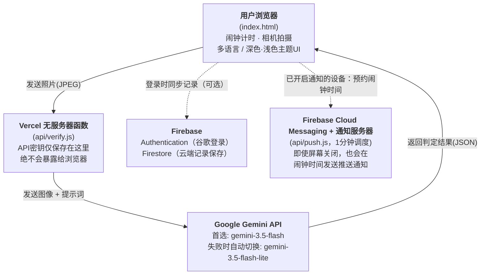

# 💧 Water-Cycle（饮水计时器项目）

**🌐 Language**: [한국어](./README.md) · [English](./README.en.md) · [日本語](./README.ja.md) · 中文（本文档）


> 第4届 NAVER OGQ Market AI Competition 参赛作品 · 团队 **AI도 놀랄 팀（连AI都会惊讶的团队）**
> 领域：① IT·软件·机器人

**🔗 在线演示**: https://drink-water-five-drab.vercel.app/
**🔗 评审用在线演示**: https://drink-water-five-drab.vercel.app/?judge=1 （会显示无需等待、立即体验闹钟的按钮；此次访问不计入统计）
**🎥 入选30强之前的3分钟演讲视频**: https://youtu.be/ApWkJ1hUQ2w
**🎥 第4周3分钟演讲视频**: https://youtu.be/brr7TZhIT9o
**🎥 最终3分钟演讲视频**: https://youtu.be/ZgaB6vrxH0U
**🎥 10分钟路演视频（第7周）**: https://youtu.be/JCmAw9Xpjqg

---

> ### 📌 一目了然（TL;DR）
> - **做什么**: 针对工业现场工作人员错过喝水时机的问题，做了一个网页应用——只有AI通过照片确认用户确实在喝水，闹钟才会关闭
> - **为什么用AI**: 仅靠点按按钮或扫二维码，无法确认“是否真的喝了水”——AI Vision判定是唯一的认证方式
> - **当前状态**: 已上线运行，支持8种语言，登录后云端保存，已实现应用内实测数据统计及故障/建议反馈功能以及屏幕关闭时也能收到的推送通知
> - **实测结果**: 访问33人 → 开始15人 → 完成15人 → 回访7人 / 最近7天认证成功的用户（北极星指标）13人（目标10人）（以所有者专属仪表盘为准，详见下文“14. 测量与改进”）

---

## 项目概述

**Water-Cycle（饮水计时器项目）** 针对洁净室、生产现场等因工作性质而容易忽视补水的环境，引导作业人员每隔固定周期自然地离开工作区域补充水分，并通过 **AI进行认证**，是一个与考勤联动的健康管理项目。它不是单纯的活动式挑战，而是设计了一套与真实工作动线相结合、可重复的流程（Cycle），同时实现习惯养成与认证。

**Water-Cycle** 这个名字象征着“闹钟 → 移动 → 饮水 → 认证”这一闭环结构（Cycle），随着循环不断重复，习惯也随之积累。

## 1. 问题定义

我们团队由忠南半导体工匠高中的在校生组成，所以最初想到的是我们最熟悉的半导体晶圆厂洁净室工作环境。半导体晶圆厂的进入程序严格，需要穿防尘服、经过风淋等，比普通办公环境更难喝水，而且长时间专注工作会让人感觉不到口渴，或者即使感觉到也难以付诸行动。

然而，在半导体产业展会现场进行的6次真实用户访谈中，我们新发现了两点。第一，**不穿防尘服的普通工业工人同样面临“没时间喝水，或者嫌麻烦就不怎么喝”的相同问题。** 第二，半导体晶圆厂洁净室禁止携带相机，且防尘服手套让触屏操作也很困难，所以我们最初设想的“AI拍照认证”方式，恰恰难以应用在半导体现场，这个现实限制也一并被发现。

因此，我们没有把问题范围局限在半导体产业，而是扩大到**难以自己把握补水时机的所有工业现场工作人员**。在对相机使用没有限制的一般制造、物流、服务现场，直接应用AI拍照认证；而对于限制携带相机的半导体洁净室等特殊环境，则作为后续扩展课题单独处理（见第9节）。

由此造成的长期缺水，可能导致注意力下降、疲劳积累以及安全事故风险增加。

现有的简单闹钟应用或点击式清单，有一个根本局限：无法确认“已注意到闹钟”与“真的喝了水”之间的差距。**Water-Cycle用AI Vision弥合了这一差距。** 闹钟在设定时间响起，只有用户拍下自己真正喝水的画面，AI判定后才会解除闹钟。不是单纯的提醒，而是通过“行为验证”来促成习惯，这是我们的核心差异点。

### 利用现有动线的好处
把补水自然地融入作业人员本来就要经过的“离开作业区 → 休息区”动线，可以降低对额外耗时的心理抗拒，提高现场接受度。

## 2. 实际使用场景（完整循环）

```
① 确认闹钟 → ② 收尾手头工作 → ③ 离开作业区域 → ④ 在饮水处补水 → ⑤ 在应用中进行AI认证 → （等待下一次闹钟，回到①循环）
```

其中 **①和⑤（闹钟触发、AI拍摄认证）** 已在应用中实现，②~④是作业人员在现场实际完成的物理动线。

## 3. 架构

浏览器（前端）完全不知道AI API密钥。它只把拍摄的照片发送给我们自己的后端服务器，由后端使用保存在环境变量中的密钥代为调用AI API。AI判定做了冗余设计：当主模型无响应时，会在同一服务内自动切换到备用模型；记录保存则根据是否登录，分为浏览器存储或云端。



- 拍摄的图像会为判定而发送一次至Google Gemini API，我们的服务器和数据库不保存，判定后立即销毁。但根据目前使用的Gemini免费版条款，Google可能将收到的内容用于改进服务，审核人员也可能查看，因此应用的同意窗口会告知这一点，并引导用户只拍手和杯子、不拍脸。用户增多后，计划改用不将输入用于训练的付费版。
- **不登录也可以完整使用所有功能。** 这种情况下，今天的认证记录、统计和设置保存在浏览器存储中，刷新后依然保留。
- **使用谷歌账号登录后**，同样的记录会保存到Firestore（云端），更换设备或清除浏览器后依然保留，并可单独查看过去14天的记录。
- **屏幕关闭时的提醒（可选）**：手机屏幕关闭后会暂停网页，因此用户开启提醒后，计时开始时闹钟时间会预约到服务器（`api/push.js`），每分钟运行的调度器（cron-job.org）会通过 Firebase Cloud Messaging 向到点的预约发送推送。在完成验证之前，每分钟最多重复提醒5次。

## 4. 技术栈

| 领域 | 技术 |
|---|---|
| 前端 | HTML / CSS / Vanilla JavaScript（无框架） |
| 后端 | Vercel Serverless Functions (Node.js) |
| AI模型 | Google Gemini — `gemini-3.5-flash`（首选） / `gemini-3.5-flash-lite`（失败时自动切换） — Vision（图像理解）API |
| 登录 · 云端存储 | Firebase Authentication（谷歌登录）、Cloud Firestore |
| 测量 · 反馈 | Firestore `events`（匿名事件） · `feedback`（反馈箱）、Web3Forms（反馈邮件转发） |
| 推送通知 | Firebase Cloud Messaging（网页推送）、Service Worker、Firebase Admin SDK（`api/push.js`）、cron-job.org（1分钟调度） |
| 加分功能 | OGQ Market API — 认证成功时的贴纸奖励（`api/sticker.js`） |
| 部署 | Vercel |
| 版本管理 | GitHub |
| 多语言 | 한국어 / English / 日本語 / 中文 / Tiếng Việt / ภาษาไทย / Bahasa Indonesia / Tagalog（共8种语言，自行实现的i18n） |

## 5. 运行方法

### 立即体验（推荐）
访问[在线演示](https://drink-water-five-drab.vercel.app/) → 点击 **“⚡ 立即测试闹钟（评审用）”** 按钮（在网址末尾加上 `?judge=1` 时显示，此次访问不计入统计），无需等待即可体验闹钟 → 用相机拍摄喝水的画面 → 查看AI判定结果
（无需登录即可体验全部功能，也可在右上角选择性测试谷歌登录。）

### 本地运行
```bash
git clone https://github.com/ljh30581712-beep/drink-water.git
cd drink-water
npm i -g vercel
vercel dev
# 运行前需要注册环境变量。
#  - GEMINI_API_KEY : 在 Google AI Studio (https://aistudio.google.com/apikey) 申请
#  - OGQ_API_KEY    : （可选）用于OGQ Market贴纸。没有它核心功能也能正常运行
# 若要使用登录/云端存储功能，需要创建Firebase项目，
# 并把 index.html 中 firebaseConfig 的值替换为你自己项目的值。
```

### 部署
1. 将GitHub仓库导入（Import）到Vercel
2. 在Vercel项目的Settings → Environment Variables中注册 `GEMINI_API_KEY`（必需）、`OGQ_API_KEY`（可选）。如需推送通知，还需注册 `FIREBASE_SERVICE_ACCOUNT`（Firebase服务账号JSON）和 `CRON_SECRET`（任意字符串）
3. Deploy
4. （可选）在Firebase控制台启用Authentication（谷歌登录）和Firestore，并把部署后的域名添加到“已授权的域名”
5. （可选）发布Firestore规则（`firestore.rules`）：events和feedback仅可写入，读取仅限所有者账号
6. （可选）反馈邮件：把从web3forms.com获得的Access Key填入 `index.html` 的 `EMAIL_FORM_KEY`
7. （可选）推送通知：在Firebase控制台 → Cloud Messaging中创建Web推送证书（VAPID密钥），填入 `index.html` 的 `VAPID_KEY`，并在cron-job.org等外部调度器中设置每分钟调用 `/api/push?key=<CRON_SECRET>`

## 6. AI使用说明

**核心功能（服务的必要组成部分）**

| 项目 | 内容 |
|---|---|
| 使用的AI模型 | Google Gemini — `gemini-3.5-flash`（首选）、`gemini-3.5-flash-lite`（备用） |
| 使用方式 | 用Vision（图像理解）功能分析用户拍摄的一张照片，判定是否为“喝水/饮料的动作”。以JSON形式接收判定结果（true/false）和简短理由，据此决定是否解除闹钟 |
| 冗余设计的原因 | 热门模型有时响应会暂时延迟，此时自动切换到同一服务内更轻量的模型，以提高服务稳定性 |
| 使用范围 | **认证方式只有AI拍照判定。** 仅点击按钮或扫描二维码不能完成认证，没有AI判定，服务就无法成立。 |
| 辅助API | OGQ Market API — 验证成功后提供OGQ Market贴纸作为奖励(`api/sticker.js`)。它是独立于AI判定的附加功能,调用失败也不影响验证、闹钟等核心功能 |

**开发辅助工具（在策划与制作过程中使用）**

| 工具 | 使用目的 |
|---|---|
| Claude (Anthropic) | 全部代码编写与调试、架构设计、部署方法指导 |
| Gemini | 创意构思与策划辅助 |
| HyperCLOVA X | 撰写README等Markdown文档时的语法运用与语句润色 |
| ChatGPT（图像生成） | 制作团队Logo |

## 7. 隐私与伦理（P/F检查清单）

| 检查项目 | 应对内容 |
|---|---|
| **隐私保护** | 拍摄的图像为了AI判定发送一次至Google Gemini API，不保存在我们的服务器或数据库中。由于Gemini免费版条款允许Google将收到的内容用于改进服务并由审核人员查看，同意窗口会告知这一点并引导用户不要拍到脸（用户增多时改用付费版）。没有人脸识别或身份识别功能，只判定“是否有喝水行为”。登录时保存的信息仅有饮水记录和设置值；测量用事件仅以随机匿名ID记录，不包含姓名、照片、位置。通过Firestore安全规则，限制只能访问本人账号的数据。 推送通知仅在用户开启时运行，此时只会在服务器临时保存设备通知地址、下一次闹钟时间和语言，闹钟结束或关闭该功能后即删除。 |
| **版权** | 代码、图标、字体仅使用自制或开源/免费授权的资源。 |
| **AI生成物标注** | 在“6. AI使用说明”中明确公开了所使用的AI模型及使用范围。 |
| **未成年人安全** | 本服务面向工业现场的成年工作人员设计，不以未成年人使用为前提。 |

## 8. 目前已实现的功能

- **闹钟系统**: 按设定周期触发单次闹钟，可重置今天的记录
- **5分钟推迟（贪睡）**: 闹钟响起时若正在从事危险作业或在移动而难以立即认证，可用“推迟5分钟”按钮暂时关闭，5分钟后重新响起。**每次闹钟仅允许一次**，再次响起后会持续响铃，直到真正喝水并完成AI认证。
- **AI认证系统**: 相机拍摄 → Gemini Vision判定（首选失败时自动切换备用模型） → 解除闹钟，失败时提供重新拍摄按钮
- **登录 · 云端记录保存（可选）**: 使用谷歌账号登录后，记录保存到Firestore，更换设备也能保留，并可查看过去14天的记录。不登录时，使用浏览器存储也能同样运行。
- **统计**: 实时汇总今天的尝试/成功/失败次数、成功率、平均认证间隔
- **多语言**: 한국어 / English / 日本語 / 中文 / Tiếng Việt / ภาษาไทย / Bahasa Indonesia / Tagalog 共8种语言实时切换（AI判定理由也以所选语言返回）
- **深色/浅色模式**: 即时切换屏幕主题的明暗色调
- **无障碍/稳定性**: 离线状态提示、读屏器标签、按原因区分的错误提示（超出额度/超时/服务器繁忙/网络等）
- **OGQ贴纸奖励**: 认证成功时展示OGQ Market贴纸作为奖励（即使失败也不影响核心功能）
- **设置**: 振动、3种闹钟铃声、每日开始时间（考虑倒班）、拍摄前的屏幕补光、隐私同意提示
- **匿名测量**: 以匿名ID记录访问、开始、完成、回访、错误事件（在所有者仪表盘中查看）
- **故障与建议反馈**: 应用内💬反馈按钮 → 同时发送到反馈箱和邮箱
- **屏幕关闭也能响的提醒（推送）**：在设置中开启后，服务器会在闹钟时间向手机发送推送，并在完成验证之前每分钟最多重复提醒5次（回到应用后停止）。提醒最多可能延迟1分钟，iPhone 仅在"添加到主屏幕"的应用中才能接收。
- **提醒指引窗口**：在应用内按 iPhone 和 Android 分别说明设置步骤，并提醒使用 NAVER、KakaoTalk 等应用内浏览器的用户改用 Safari 或 Chrome 重新打开。首次开启计时时自动弹出一次。
- **计时校正**：剩余时间按"结束时刻"计算，屏幕关闭再亮起时时间不会错乱，返回应用的瞬间闹钟立即响起。计时期间还会请求保持屏幕常亮（Wake Lock）。

## 9. 未来扩展构想

以下内容尚未实现，是8周辅导结束后仍会继续发展的计划。

- **双闹钟结构**: 增加与离开作业区时间相匹配的第二次闹钟
- **倒班模式自动调整**: 随着换班自动更改闹钟周期
- **二维码出入标记**: 在工作场所出入口张贴二维码，工作人员离开时扫码即可自动记录离开时间，并据此校正饮水闹钟的时机（认证本身仍与现在一样采用AI拍照判定，二维码只起“掌握离开时间点”的辅助作用）
- **应对限制携带相机的现场**: 针对像半导体洁净室这样出于安保原因禁止携带相机、或因防尘服手套难以触屏操作的特殊环境，研究在饮水处安装流量传感器或用工牌刷卡认证的替代方式（针对半导体产业展会访谈中实际确认的限制条件）
- **管理员仪表盘**: 按部门/产线汇总、向认证率低的人员发送提醒、下载统计报告（Excel/PDF）
- **数据联动分析**: 将认证数据与公司体检数据联动，按季节（高温期）自动缩短闹钟周期
- **可视化**: 按饮水处位置展示使用情况的热力图

## 10. 适用行业案例

Water-Cycle的核心原理（**“固定时间响起闹钟 → 用AI验证真实行为”**）不局限于特定行业，**可直接应用于各种需要管理补水的现场**。

| 现场 | 应用示例 |
|---|---|
| 半导体晶圆厂洁净室 | 面向穿防尘服的工作人员。但在禁止携带相机的区域，需要采用第9节的替代认证方式（传感器·工牌刷卡） |
| 医院（手术室·重症监护室等） | 面向穿无菌服、因长时间手术而容易错过补水的医护人员 |
| 建筑工地 | 预防夏季高温下户外作业人员中暑 |
| 物流中心·一般制造工厂 | 以相同结构应用于各类生产岗位的工作人员 |
| 呼叫中心·办公室职员 | 长时间坐着工作、容易忘记补水的环境 |
| 养老机构 | 作为面向难以自己察觉和表达口渴的老年人的看护人、护理员的提醒工具加以应用 |
| 运动·健身 | 管理高强度运动中的补水时机 |

也就是说，保留“用AI拍照判定来验证行为”这一结构本身，**只需更换闹钟周期和目标用户，就能扩展为可在多个行业复用的通用解决方案**。这意味着它不是局限于单一行业的小众产品，而是可以面向多个行业以B2B方式授权、或以SaaS形式销售的**商业化潜力**。

## 11. 多语言本地化策略

我们不只是把界面文案翻译成8种语言，还考虑了各语言圈用户的使用体验。

- **基于现场的语言选择**: 优先纳入了韩国制造业现场外籍劳工来源国的语言。
- **文体本地化**: 日语采用适合工业现场工具的礼貌体（丁寧語）语气，英语采用国际工作环境中通用的简洁说明语气，分别单独撰写。没有直接粘贴机器翻译，而是按各语言重新组织了自然的句子。
- **AI判定结果的语言联动**: 拍照判定后返回的“判定理由”文本，也会以用户所选语言直接生成，因此会把语言信息一并传给服务器。避免出现只翻译界面、AI回答却只有韩语的半吊子多语言。
- **客户支持的多语言化**: 应用内的“常见问题（FAQ）”同样以8种语言提供，让用户没有语言障碍，也能自己解决问题。
- **技术文档的多语言化**: 本README提供韩语、英语、日语、中文4种语言版本，方便海外评审和导入企业负责人直接了解结构和运行方法。

## 12. 维护与技术支持体系

作为B2B解决方案，我们假设会部署到真实的工业现场，并设计、应用了下面的运营体系。

### 部署·更新流程
- 代码通过GitHub的 `main` 分支管理，提交生效后Vercel自动重新部署。
- 前端无需另行安装或更新应用，用户刷新页面即可应用最新版本。
- 后端（无服务器函数）也使用相同的部署流水线，因此始终与前端保持同一版本。

### 问题响应流程
1. **监控**: 通过Vercel函数日志和Google AI Studio用量仪表盘，实时查看错误与流量。
2. **原因分类**: 把错误分为网络/AI服务故障/代码缺陷，缩小原因范围。（例如，在这次开发过程中，用这种方式分别诊断并处理了504超时、503服务器拥堵、404模型下线等问题。）
3. **修补并重新部署**: 确认原因后修改代码并提交，通过自动重新部署即时生效。
4. **记录**: 把应对过程记录在“开发历史”（下文第15节）中，以便同样的问题再次发生时能快速参考。

### 技术支持渠道（计划）
- **一级自助支持**: 通过应用内多语言FAQ，可立即查看常见问题（闹钟没声音、相机错误等）
- **二级咨询渠道**: 应用内💬反馈按钮（已运行）接收错误和建议，并计划增加GitHub Issues作为官方故障反馈入口
- **响应目标**: 服务中断级别的错误，目标是确认后24小时内做出首次响应（目前是团队项目阶段的目标值，正式商业化时计划具体化为SLA）

### 第8周之后的运营计划
- **故障处理**：通过应用内💬反馈按钮提交的错误和建议会立即送达收件箱和邮箱，确认后马上修复。同时定期查看实时看板中的AI错误记录（类型、状态码、耗时），出现错误就分析原因并修复。
- **维护成本**：目前在免费套餐额度内运行，没有固定的月费用（托管：Vercel；数据库、登录、推送通知：Firebase；提醒调度：cron-job.org）。只有在用户增多、AI判定（Gemini）调用量超过额度时才会产生费用，届时将按使用量考虑升级付费套餐。照片不会保存在服务器上，因此也没有存储费用。
- **扩大用户**：已开通Instagram账号（@water_cycle.ai），正在准备产品推广的Reels视频。通过看板确认新用户是否会再次访问，并据此改进。
- **应用商店上架计划**：网页服务稳定后，计划将应用上架App Store（iOS）和Google Play（Android），以便在屏幕关闭时更可靠地发送提醒，并让用户更容易安装。

### 未来计划
- 引入可追踪发布历史的 `CHANGELOG.md`
- 为引入企业的负责人撰写单独的运营指南文档

## 13. 预期效果

- **健康方面**: 通过定期补水减轻疲劳、保持注意力、预防中暑
- **安全方面**: 防止因口渴、脱水造成的瞬间注意力下降，降低工业安全事故风险
- **运营方面**: 利用现有工作动线，无需额外耗时即可养成习惯
- **数据方面**: 通过认证数据的积累，可用作个人/部门健康管理指标

## 14. 测量与改进（W6~W8）

### 应用自己记录的指标
我们不靠问卷，而是靠**应用自己留下的匿名事件**来测量。不保存可识别个人身份的信息，只使用每个浏览器随机生成的匿名ID。

| 事件 | 含义 |
|---|---|
| visit | 打开了链接 |
| start | 尝试了拍摄 |
| complete | 通过了AI认证 |
| return | 在另一天再次访问 |
| error | 发生了AI错误（仅记录类型·状态码·耗时） |

团队成员和评审用访问（`?judge=1`）会被标记为 `internal`，不计入统计。

### 测量结果（以所有者仪表盘为准）
| 漏斗阶段 | 人数 |
|---|---|
| 访问 | 33 |
| 开始 | 15 |
| 完成 | 15 |
| 回访 | 7 |

- **北极星指标**：最近7天内通过AI验证的外部用户 **13人**（W1起点0人 → 目标10人，达成率130%）
- 最大的流失出现在 **访问 → 开始（33 → 15，54.5%）**，尝试拍照的15人全部通过了验证。
- 在其他日期再次到访的用户为 **7 / 33（21.2%）**。第1周的30名用户中，第2周（仅10/12一天）再次到访的有4人（13.3%），由于第2周只有一天，属于暂定值。
- 测量期间为 2026-10-05 ~ 10-12（8天），外部事件321条，已排除团队及评审访问57条。样本较小，数字只反映趋势。（看板截图附在第8周最终KPI报告中）

### 仪表盘访问方式
`stats.html`（漏斗·留存·按日统计·AI错误记录）和 `inbox.html`（反馈箱）**必须使用所有者的谷歌账号登录**才能读取数据。即使页面网址公开，数据也会被Firestore安全规则拦截。评审时，会在提交材料中附上仪表盘截图。

### 故障与建议反馈功能
- 任何人都可以用应用顶部“在线”标识旁的 **💬反馈** 按钮发送故障或建议。
- 反馈会同时发送到 ① Firestore反馈箱（在 `inbox.html` 中查看）和 ② 所有者邮箱。只要其中一处成功就算已接收。
- 反馈会附带最近一次AI错误的类型和耗时，用于查找原因。不收集姓名和联系方式。

### 通过测量发现并修复的问题
| 发现 | 措施 |
|---|---|
| 间歇性超时(504)错误 | 按类型和耗时自动记录错误，区分服务器时限问题与AI侧拒绝(503·429) |
| 问卷中有人反映“在设置里输入数字时卡顿” | 设置面板打开期间，不再每秒重新渲染整个画面 |
| 缺少错误反馈渠道 | 增加应用内反馈按钮 + 反馈箱 + 邮件转发 |
| 设为5分钟，测量后变回30分钟 | 在云端数据加载完成之前不再保存 |
| 登录状态下过往记录和饮水量被覆盖为0 | 改变了旧状态的标签页/设备覆盖服务器记录的结构，仅在数值真正变化时才保存 |
| 手机屏幕关闭后计时停止 | 按结束时刻计算 + 保持屏幕常亮 + 增加服务器推送通知 |

## 15. 开发历史（问题应对记录）

| 阶段 | 问题 | 解决 |
|---|---|---|
| 第1版 → 第2版结构转换 | 前端直接调用AI API，导致在部署环境之外无法运行 | 全面改为前后端分离架构，API密钥只保存在服务器 |
| AI判定失败 | 因AI响应解析方式的问题，真实的喝水场景也出现误判 | 改用JSON结构化响应，并放宽判定标准 |
| 504超时 | 服务器冷启动 + AI分析时间超出函数时限 | 提高函数时限，优化拍摄图像分辨率以提升处理速度 |
| 503服务器拥堵 | 受热门模型影响，Gemini服务器暂时返回过载响应 | 引入主模型失败时自动切换到同一服务内备用模型的冗余结构 |
| 闹钟无声/过弱 | 浏览器自动播放策略及手机环境导致声音无法播放或太小 | 在用户点击时预先激活音频、切换画面时的恢复逻辑、调高音量、增加振动 |
| 错误提示令人困惑 | 状态码被直接显示，用户难以了解原因 | 按原因（超出额度/超时/服务器繁忙/网络）提供符合所选语言的提示语 |
| 记录丢失 | 只用浏览器存储，更换设备或清除浏览器时记录会消失 | 增加谷歌登录 + Firestore云端存储功能（登录保持为可选项） |
| 重新界定目标范围 | 半导体产业展会现场访谈（6次）发现：半导体晶圆厂洁净室禁止携带相机，且防尘服手套让触屏操作困难，难以应用AI拍照认证；而不穿防尘服的普通工业工人同样存在缺水问题 | 把服务对象从仅限半导体产业，扩大到对相机使用没有限制的工业现场整体。对禁止携带相机的特殊环境（半导体洁净室等）的应对，作为单独的后续课题分离出来 |
| 缺少测量 | 除问卷外，没有确认实际使用情况的手段 | 构建应用内匿名事件测量 + 所有者专属仪表盘（漏斗·留存·北极星） |
| 超时原因不明 | 同样是504，无法区分是服务器问题还是AI拒绝 | 在error事件中记录类型·状态·耗时，并通过反馈箱和邮件收集用户反馈 |
| 间隔设置被重置 | 登录时在加载云端数值之前就保存了之前的状态，5分钟被还原成30分钟 | 加载期间不再保存 |
| 过往记录被覆盖为0 | 同一账号下打开的其他标签页/设备每秒用旧状态覆盖服务器 | 改为仅在数值真正变化时保存，并通过双标签页复现测试验证 |
| 屏幕关闭时闹钟不响 | 屏幕关闭后手机会暂停浏览器，应用内计时无法运行 | 引入按结束时刻计时的计时器 + 服务器在闹钟时间发送推送通知的结构（FCM，1分钟调度） |
| 应用内浏览器登录被拦截 | 在NAVER、KakaoTalk等应用内浏览器中,Google登录因政策被拦截(`disallowed_useragent`);NAVER登录不是Firebase内置方式 | 检测到应用内浏览器时提示用外部浏览器(Chrome/Safari)打开;登录仅保留Google一种,并保持无需登录也可使用 |
| 仪表盘数据失真 | 访客/回访指标混入了开发者和测试设备的事件,且本周只有一天数据时回访率计算不准 | 排除内部事件,按匿名ID去重,并在报告中注明统计周期较短指标的局限 |
| 后台推送搭建(耗时最长) | 推送不只是应用代码:VAPID密钥、服务账号、服务器环境变量、外部调度器(Vercel免费方案不支持每分钟cron)以及iOS添加到主屏幕都必须齐备,期间多次出现配置错误 | 确定为服务器函数(`api/push.js`)加每分钟外部调度器的结构,密钥只通过环境变量管理(泄露的密钥立即作废并重新签发),并在应用内加入分环境的设置指引 |

## 结语

**Water-Cycle** 通过“闹钟 → 收尾 → 离开 → 饮水 → AI认证”这一完整闭环，目标是让补水习惯在各类工业现场都能顺利养成。充分利用现有动线以提高现场接受度，并以AI认证数据为基础发展为可持续改进的系统，是本项目的核心方向。

## 许可证

本项目遵循 [MIT License](./LICENSE)。
