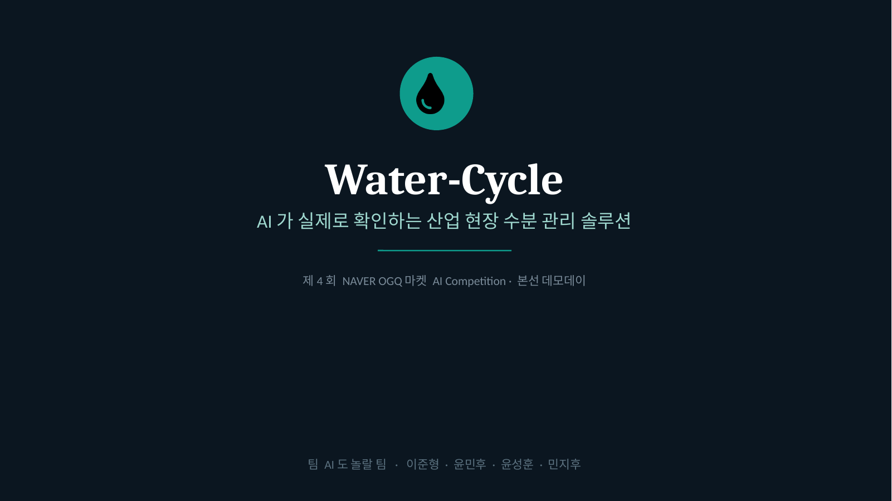
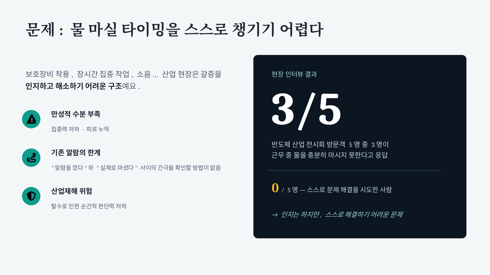
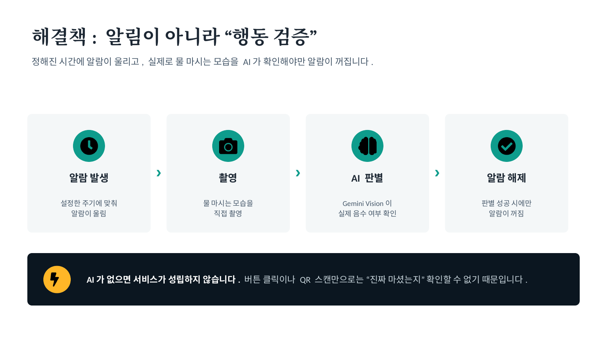
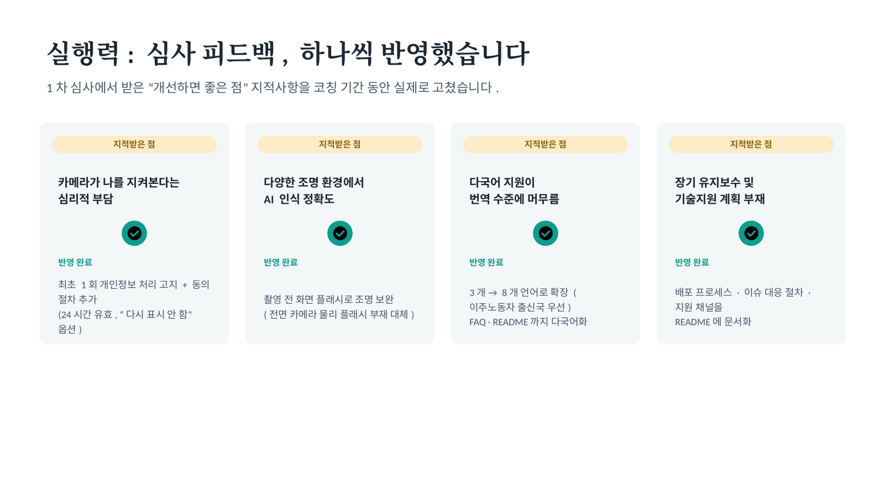
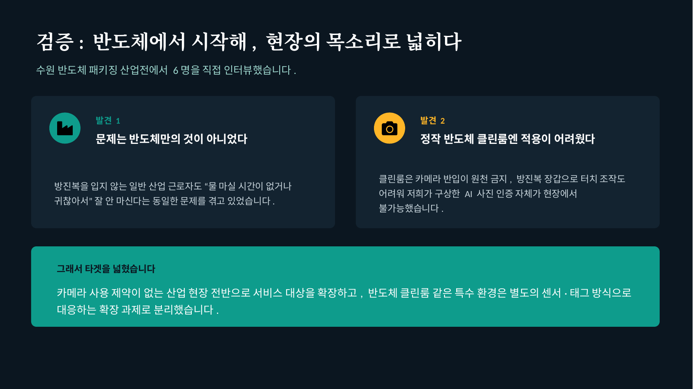
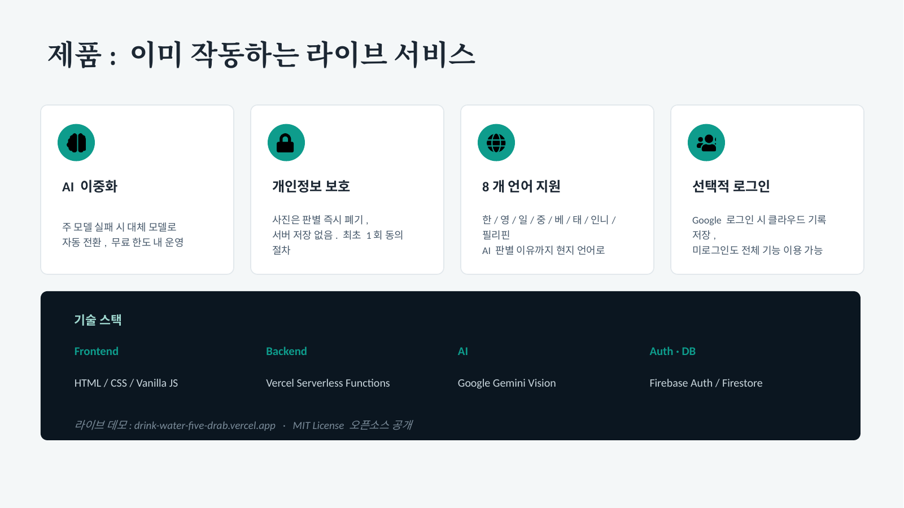
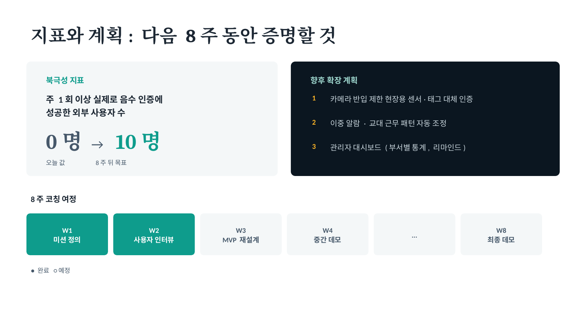
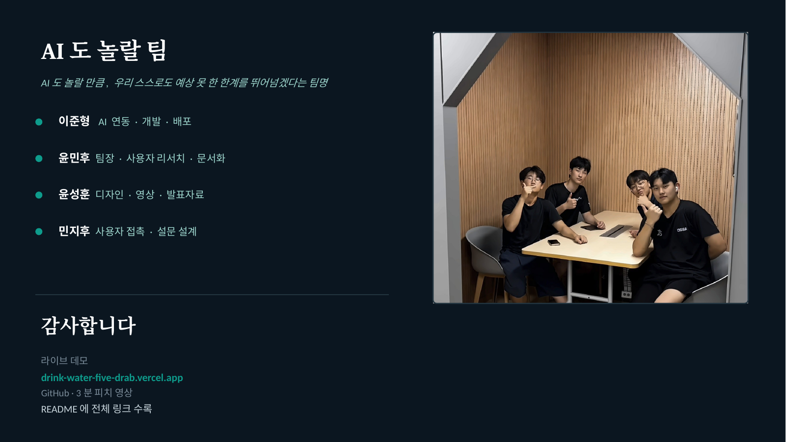

# W4 · 1차 데모 발표자료

**팀**: AI도 놀랄 팀 (Water-Cycle) · 이준형, 윤민후, 윤성훈, 민지후

4주차 1차 데모데이에서 발표한 슬라이드입니다. (PDF: [4주차_1차데모_발표자료.pdf](./4주차_1차데모_발표자료.pdf))

### 1. 표지 — Water-Cycle

### 2. 문제 — 물 마실 타이밍을 스스로 챙기기 어렵다

### 3. 해결책 — 알림이 아니라 "행동 검증"

### 4. 실행력 — 1차 심사 피드백 반영

### 5. 검증 — 수원 반도체 패키징 산업전 인터뷰 6명

### 6. 제품 — 이미 작동하는 라이브 서비스

### 7. 지표와 계획 — 다음 8주 동안 증명할 것

### 8. 팀 소개 — AI도 놀랄 팀

