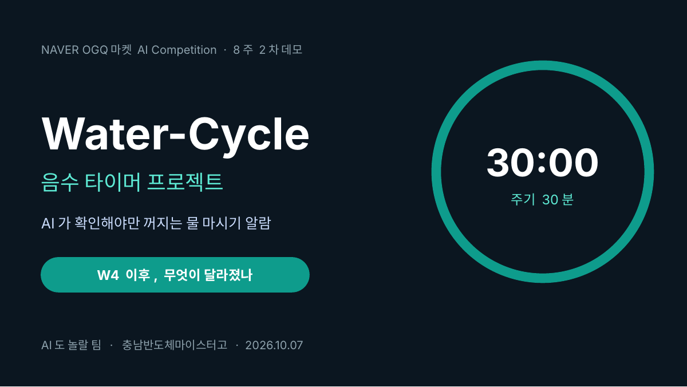
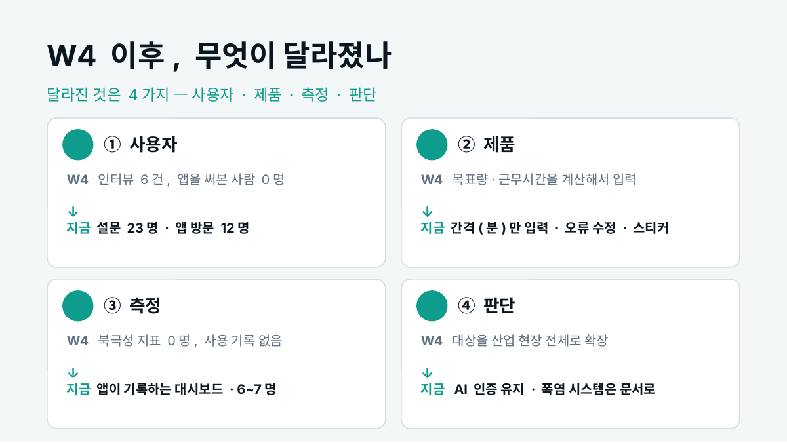
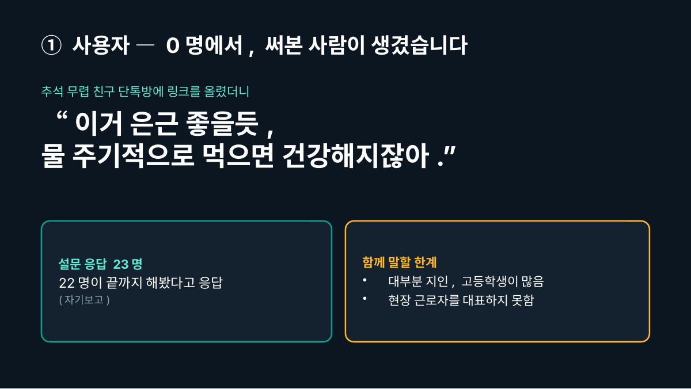
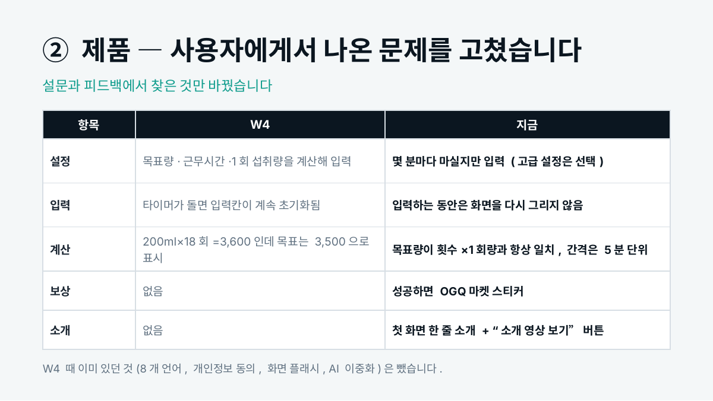
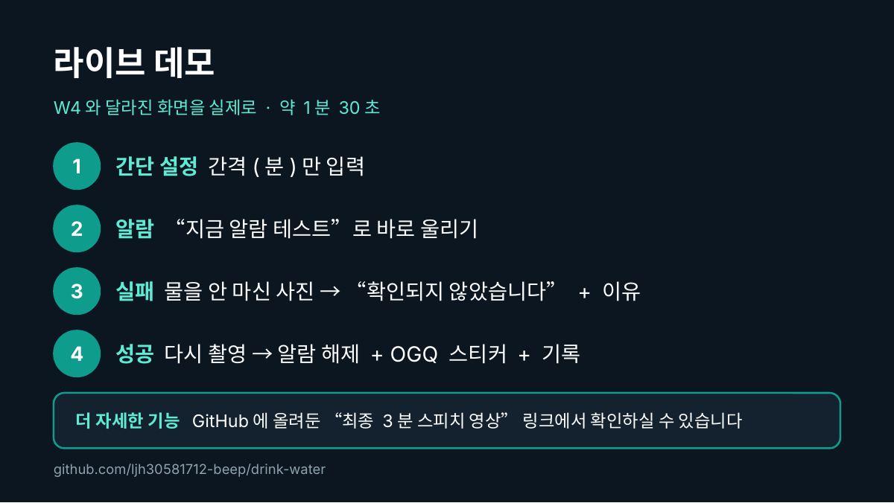
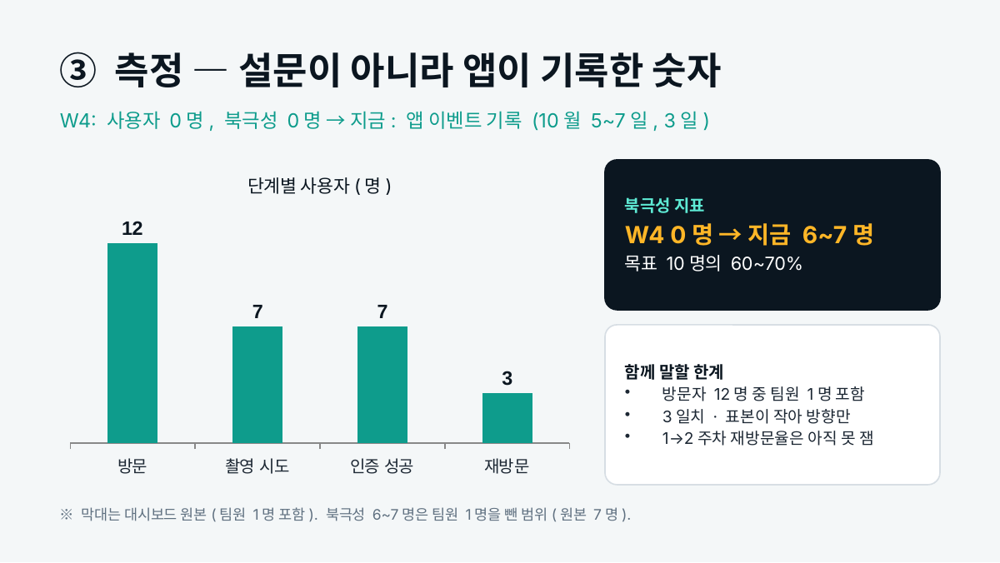
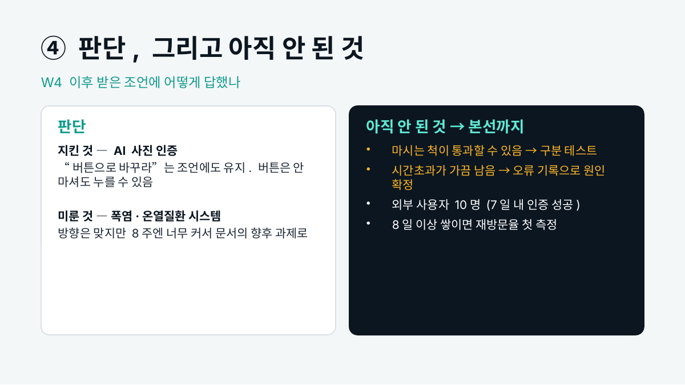
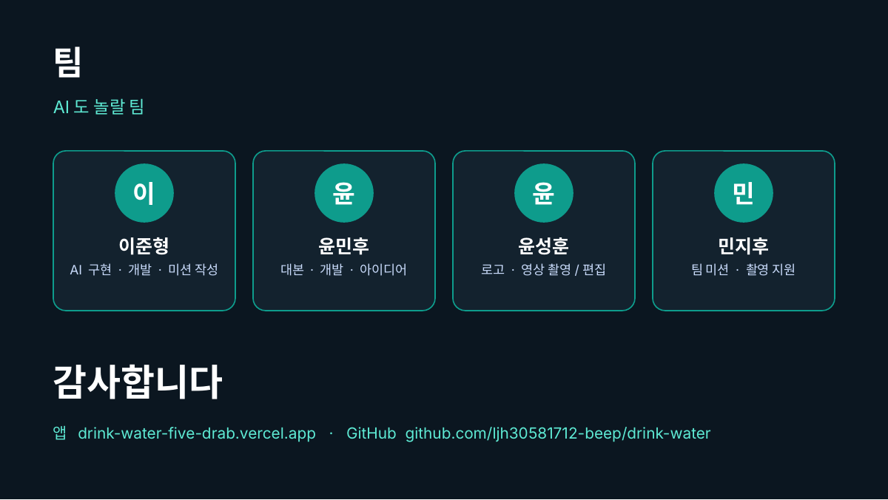
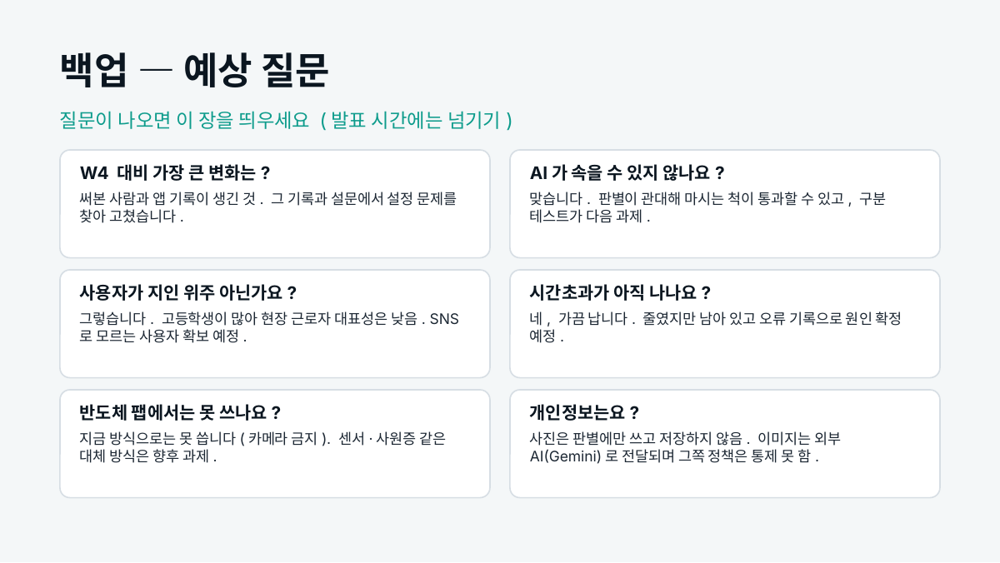

# 2차 데모 발표자료 (2026.10.07)

**팀**: AI도 놀랄 팀 (Water-Cycle) · 이준형, 윤민후, 윤성훈, 민지후

2차 데모데이에서 발표한 슬라이드입니다. 주제는 **"4주차(1차 데모) 이후 무엇이 달라졌나"** 입니다.

- 슬라이드 PDF: [2차데모_발표자료.pdf](./2차데모_발표자료.pdf)
- 발표 대본 PDF: [2차데모_발표대본.pdf](./2차데모_발표대본.pdf)

---

### 1. 표지

> **발표 대본**
>
> 안녕하세요, AI도 놀랄 팀입니다. 음수 타이머 프로젝트, Water-Cycle를 발표하겠습니다.

---

### 2. W4 이후, 무엇이 달라졌나

> **발표 대본**
>
> 오늘은 4주차 데모 때와 비교해서 무엇이 달라졌는지를 말씀드리겠습니다. 달라진 것은 네 가지입니다. 사용자, 제품, 측정, 그리고 판단입니다. 마지막에는 아직 안 된 것도 말씀드리겠습니다.

---

### 3. ① 사용자 — 0명에서, 써본 사람이 생겼습니다

> **발표 대본**
>
> 첫째, 사용자입니다. 4주차 때 저희는 산업전 인터뷰 6건이 전부였고, 앱을 실제로 써본 사람은 없었습니다. 그 뒤 추석 무렵 친구 단톡방에 링크를 올렸더니 이런 답이 왔습니다. "이거 은근 좋을듯, 물 주기적으로 먹으면 건강해지잖아." 설문에는 23명이 응답했고, 그중 22명이 끝까지 해봤다고 답했습니다. 다만 대부분 지인이고 고등학생이 많아서, 현장 근로자를 대표하지는 못합니다.

---

### 4. ② 제품 — 사용자에게서 나온 문제를 고쳤습니다

> **발표 대본**
>
> 둘째, 제품입니다. 설문에서 설정이 어렵다는 의견이 나와서, 4주차 때 목표량과 근무시간을 계산해 넣던 것을 몇 분마다 마실지만 입력하는 간단 설정으로 바꿨습니다. 숫자를 입력하면 버벅거리던 문제와 목표량 계산이 맞지 않던 오류도 고쳤고, 대회가 제공한 OGQ마켓 스티커를 성공 보상으로 붙였습니다. 직접 보여드리겠습니다.

---

### 5. 라이브 데모

> **발표 대본**
>
> 테스트 버튼으로 알람을 바로 울리겠습니다. 시간 설정은 이렇게 분 단위로만 넣으면 됩니다. 먼저 물을 마시지 않는 모습을 찍어보겠습니다. [기다리는 동안] AI가 판별하는 중입니다. 확인되지 않았다는 문구와 이유가 나옵니다. 다시 마시는 모습을 찍으면 알람이 꺼지고 스티커가 나오며 기록에 쌓입니다. 여기까지가 테스트였습니다. 더 자세한 기능은 깃허브에 올려둔 최종 3분 스피치 영상 링크를 타고 들어가서 확인해 보실 수 있습니다. [실패 시] 녹화 영상으로 바꿔서 보여드립니다. (발표자 메모: ?judge=1 링크로 접속)

---

### 6. ③ 측정 — 설문이 아니라 앱이 기록한 숫자

> **발표 대본**
>
> 셋째, 측정입니다. 4주차 때는 사용 기록이 없어서 북극성 지표도 0명이었습니다. 지금은 설문이 아니라 앱이 직접 기록하는 대시보드가 있습니다. 10월 5일부터 사흘간, 링크를 연 사람 12명, 촬영을 시도한 사람 7명, 인증에 성공한 사람 7명, 다른 날 다시 온 사람 3명입니다. [발표 직전 대시보드로 확인] 이 중 1명은 팀원입니다. 북극성 지표는 0명에서 지금 7명으로 목표 10명의 70%이고, 팀원 1명을 빼면 6명에서 7명입니다. 사흘치라 방향만 보여주고, 1주차에서 2주차 재방문율은 아직 재지 못했습니다.

---

### 7. ④ 판단, 그리고 아직 안 된 것

> **발표 대본**
>
> 넷째, 판단입니다. 4주차 때 대상을 반도체 팹에서 일하는 사람 전체로 넓혔는데, 그 뒤 AI 사진 인증을 버튼으로 바꾸라는 조언을 받았습니다. 버튼은 안 마셔도 누를 수 있어서 AI 인증을 유지했습니다. 폭염 안전관리 시스템으로 키우라는 조언은 방향은 맞지만 8주 안에는 너무 커서 문서에 남겼습니다. 아직 안 된 것도 있습니다. 마시는 척이 통과할 수 있고, 시간초과가 가끔 납니다. 본선까지 외부 사용자 10명과 첫 재방문율 측정을 하겠습니다.

---

### 8. 팀

> **발표 대본**
>
> 이준형, 윤민후, 윤성훈, 민지후였습니다. 감사합니다.

---

### 9. 백업 — 예상 질문

(질문이 나올 때만 띄우는 백업 슬라이드)
